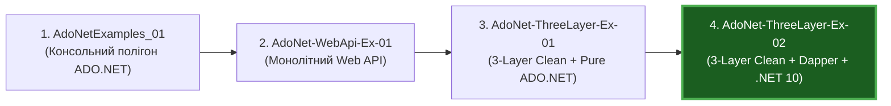

# 🌟 ASP.NET Core & ADO.NET / Dapper Enterprise Repository (Gold Standard)

> **Зразковий навчально-практичний репозиторій найвищого рівня з доступу до реляційних даних у .NET 10**  
> **Авторство та дизайн:** Enterprise Solutions Architect & Tech Lead  
> **Платформа:** .NET 10 LTS | C# 13 | Microsoft.Data.SqlClient | Dapper 2.1+ | ASP.NET Core Web API | Clean 3-Layer Architecture

---

## 🏛️ Швидка Навігація по Архітектурних Матеріалах

| Документ | Формат | Опис та Цільова Аудиторія |
| :--- | :--- | :--- |
| 🎬 **[docs/Architecture-Presentation.md](docs/Architecture-Presentation.md)** | Інтерактивна презентація (25 слайдів з повною навігацією `⬅/⬆/➡`, Mermaid-діаграмами та посиланнями на код) | Повний навчальний майстер-клас: від фундаментальних механік ADO.NET до high-load Dapper патернів (multi-mapping, транзакції, bulk operations, Clean Architecture). |
| 📘 **[docs/AdoNet-Architecture-Guide.md](docs/AdoNet-Architecture-Guide.md)** | Повний технічний довідник по ADO.NET у .NET 10 | Протокол TDS, життєвий цикл з'єднань, Connection Pooling, параметризація, захист від SQL Injection, рівні ізоляції ACID та розбір відключеної моделі `SqlDataAdapter`. |
| ⚡ **[docs/Dapper-Architecture-Guide.md](docs/Dapper-Architecture-Guide.md)** | Повний технічний довідник по Dapper у .NET 10 | DynamicMethod та IL Emit генерація, кешування десеріалізаторів за Identity, сімейство `Query/Execute`, `GridReader`, Multi-Mapping (1:1, 1:N, N:M), `CommandDefinition` та патерн Unit of Work. |
| 📊 **[pptx/Dapper.pptx](pptx/Dapper.pptx)** | Оригінальна презентація PowerPoint (27 слайдів) | Базові навчальні матеріали курсу по Dapper українською мовою. |

---

## 💾 Схеми Баз Даних та T-SQL Моделі в Проєктах

У репозиторії реалізовано автоматичне створення та наповнення двох демонстраційних баз даних на SQL Server (LocalDB):

### 1. Консольна База Даних: `AdoNet_Explanation_Ex01`
* **Таблиця:** `dbo.Books`
* **T-SQL DDL визначення:**
```sql
IF OBJECT_ID(N'dbo.Books', N'U') IS NULL
CREATE TABLE Books
(
    Id        INT           IDENTITY(1,1) PRIMARY KEY,
    Title     NVARCHAR(100) NOT NULL,
    Author    NVARCHAR(100) NOT NULL,
    PageCount INT           NOT NULL
);
```
* **Інфраструктурні інструменти:**
  * 👉 [Db.cs](AdoNetExamples_01/Infrastructure/Db.cs) 📍 (`EnsureCreatedAsync`, `SeedAsync`, `DropDatabaseAsync`, `PrintBooksAsync`)
  * 👉 [AppConfig.cs](AdoNetExamples_01/Infrastructure/AppConfig.cs) 📍 (зчитування конфігурації з `appsettings.json`)

### 2. База Даних Web API та 3-Рівневих Систем: `StudentsDb`
* **Таблиця:** `dbo.Students`
* **T-SQL DDL визначення:**
```sql
IF OBJECT_ID(N'dbo.Students', N'U') IS NULL
CREATE TABLE Students
(
    Id    INT           IDENTITY(1,1) PRIMARY KEY,
    Name  NVARCHAR(100) NOT NULL,
    Email NVARCHAR(100) NOT NULL
);
```
* **Авто-бутстрап при запуску додатків:**
  * 👉 [DatabaseBootstrapper.cs (Ex-04 Dapper)](AdoNet-ThreeLayer-Ex-02/src/AdoNet.ThreeLayer.Dapper.DAL/Infrastructure/DatabaseBootstrapper.cs) 📍 (автоматичне створення `StudentsDb` та наповнення тестовими студентами)
  * 👉 [DatabaseBootstrapper.cs (Ex-03 Pure ADO.NET)](AdoNet-ThreeLayer-Ex-01/src/AdoNet.ThreeLayer.DAL/Infrastructure/DatabaseBootstrapper.cs) 📍 (аналогічний бутстрап на чистому ADO.NET)

---

## 🧭 Еволюційна Магістраль Проєктів у Репозиторії



---

### 1. `AdoNetExamples_01` — Консольний Стенд Фундаментального ADO.NET

* **Головний файл меню:** 👉 [Program.cs](AdoNetExamples_01/Program.cs)
* **Призначення:** Демонстрація 10 ізольованих практичних прикладів роботи з `Microsoft.Data.SqlClient` та SQL Server.
* **Каталог прикладів у коді:**

| № | Приклад | Файл у репозиторії | Що демонструє під капотом |
| :-: | :--- | :--- | :--- |
| **1** | Підключення до SQL Server | 👉 [ConnectionInfoExample.cs](AdoNetExamples_01/Examples/ConnectionInfoExample.cs) | `SqlConnection.OpenAsync`, властивості з'єднання, перевірка Connection Pool |
| **2** | Створення бази й таблиці | 👉 [CreateSchemaExample.cs](AdoNetExamples_01/Examples/CreateSchemaExample.cs) | DDL-команди (`CREATE DATABASE`, `CREATE TABLE`) через `ExecuteNonQueryAsync` |
| **3** | Додавання рядків | 👉 [InsertDataExample.cs](AdoNetExamples_01/Examples/InsertDataExample.cs) | Параметризований `INSERT`, повернення кількості рядків (`Rows Affected`) |
| **4** | Зміна та видалення | 👉 [UpdateDeleteExample.cs](AdoNetExamples_01/Examples/UpdateDeleteExample.cs) | Команди `UPDATE` / `DELETE` та контроль кількості зачеплених рядків |
| **5** | Курсорне читання | 👉 [DataReaderExample.cs](AdoNetExamples_01/Examples/DataReaderExample.cs) | Потоковий `SqlDataReader`, читання вперед по одному рядку (`ReadAsync`) |
| **6** | Одне скалярне значення | 👉 [ScalarQueryExample.cs](AdoNetExamples_01/Examples/ScalarQueryExample.cs) | `ExecuteScalarAsync` для агрегатних функцій `COUNT(*)`, `MIN()`, `AVG()` |
| **7** | Параметри запиту | 👉 [ParameterizedQueryExample.cs](AdoNetExamples_01/Examples/ParameterizedQueryExample.cs) | Захист від SQL Injection, `SqlParameter`, вихідні параметри (`OUTPUT`) |
| **8** | Управління транзакціями | 👉 [TransactionExample.cs](AdoNetExamples_01/Examples/TransactionExample.cs) | `SqlTransaction` — гарантія атомарності `CommitAsync` та відкат `RollbackAsync` |
| **9** | Відключена модель даних | 👉 [DataAdapterExample.cs](AdoNetExamples_01/Examples/DataAdapterExample.cs) | `SqlDataAdapter` + `DataTable` + `SqlCommandBuilder` (розбір антипатерну) |
| **10** | Очищення ресурсів | 👉 [DropDatabaseExample.cs](AdoNetExamples_01/Examples/DropDatabaseExample.cs) | `DROP DATABASE` з попереднім `SET SINGLE_USER WITH ROLLBACK IMMEDIATE` |

---

### 2. `AdoNet-WebApi-Ex-01` — Web API з Прямим Доступом до Даних (Аналіз Наївного Підходу)

* **Точка входу:** 👉 [Program.cs](AdoNet-WebApi-Ex-01/Program.cs)
* **Контролер:** 👉 [Controllers/StudentsController.cs](AdoNet-WebApi-Ex-01/Controllers/StudentsController.cs)
* **Сервіс:** 👉 [Services/Students/StudentsServices.cs](AdoNet-WebApi-Ex-01/Services/Students/StudentsServices.cs)
* **Репозиторій:** 👉 [Services/DAL/DataAccessRepository.cs](AdoNet-WebApi-Ex-01/Services/DAL/DataAccessRepository.cs)
* **Модель:** 👉 [Models/Student.cs](AdoNet-WebApi-Ex-01/Models/Student.cs)
* **Архітектурний аналіз:** Демонструє код, типовий для ранніх етапів розробки, та викриває небезпечні антипатерни:
  * Збереження екземпляра `_sqlConnection` у полі класу репозиторію;
  * Синхронне блокування потоків виконання (`ExecuteReader()`, `ExecuteNonQuery()`), що призводить до ThreadPool Starvation;
  * Повернення відкритого `IDataReader` назовні, що блокує сокет у пулі.

---

### 3. `AdoNet-ThreeLayer-Ex-01` — Трьохрівнева Архітектура на "Чистому" ADO.NET

* **Призначення:** Класична Clean Architecture з чітким розмежуванням відповідальностей (Separation of Concerns).
* **Каталог компонентів у коді:**
  * **ШАР 1 — Presentation (Web API):**
    * 👉 [Program.cs (Api)](AdoNet-ThreeLayer-Ex-01/src/AdoNet.ThreeLayer.Api/Program.cs) — точка збірки (Composition Root), підключення Swagger та реєстрація DI.
    * 👉 [StudentsController.cs (Api)](AdoNet-ThreeLayer-Ex-01/src/AdoNet.ThreeLayer.Api/Controllers/StudentsController.cs) — REST-ендпойнти (`GET`, `POST`, `DELETE`), повернення статус-кодів 200, 201, 400, 404.
  * **ШАР 2 — Business Logic Layer (BLL):**
    * 👉 [IStudentService.cs (BLL)](AdoNet-ThreeLayer-Ex-01/src/AdoNet.ThreeLayer.BLL/Students/IStudentService.cs) — інтерфейс бізнес-операцій.
    * 👉 [StudentService.cs (BLL)](AdoNet-ThreeLayer-Ex-01/src/AdoNet.ThreeLayer.BLL/Students/StudentService.cs) — валідація інваріантів, пагінація, проекція на DTO.
    * 👉 [StudentModels.cs (BLL)](AdoNet-ThreeLayer-Ex-01/src/AdoNet.ThreeLayer.BLL/Students/StudentModels.cs) — незмінні моделі передачі даних (`StudentDto`, `CreateStudentDto`).
    * 👉 [DependencyInjection.cs (BLL)](AdoNet-ThreeLayer-Ex-01/src/AdoNet.ThreeLayer.BLL/DependencyInjection.cs) — модуль реєстрації BLL у DI.
  * **ШАР 3 — Data Access Layer (DAL):**
    * 👉 [IStudentRepository.cs (DAL)](AdoNet-ThreeLayer-Ex-01/src/AdoNet.ThreeLayer.DAL/Students/IStudentRepository.cs) — контракт сховища даних (DIP).
    * 👉 [StudentRepository.cs (DAL)](AdoNet-ThreeLayer-Ex-01/src/AdoNet.ThreeLayer.DAL/Students/StudentRepository.cs) — прямий ADO.NET: `await using`, `ExecuteReaderAsync`, ручний мапінг `Map(reader)`.
    * 👉 [Student.cs (DAL)](AdoNet-ThreeLayer-Ex-01/src/AdoNet.ThreeLayer.DAL/Students/Student.cs) — сутність таблиці БД.
    * 👉 [DatabaseBootstrapper.cs (DAL)](AdoNet-ThreeLayer-Ex-01/src/AdoNet.ThreeLayer.DAL/Infrastructure/DatabaseBootstrapper.cs) — авто-створення схеми.
    * 👉 [DependencyInjection.cs (DAL)](AdoNet-ThreeLayer-Ex-01/src/AdoNet.ThreeLayer.DAL/DependencyInjection.cs) — модуль реєстрації DAL у DI.

---

### 4. `AdoNet-ThreeLayer-Ex-02` — Зразковий Enterprise-проект: Dapper + .NET 10 (Gold Standard)

* **Призначення:** Промисловий стандарт (Gold Standard) з високою продуктивністю та лаконічним кодом.
* **Каталог компонентів у коді:**
  * **ШАР 1 — Presentation (Web API на .NET 10):**
    * 👉 [Program.cs (Api)](AdoNet-ThreeLayer-Ex-02/src/AdoNet.ThreeLayer.Dapper.Api/Program.cs) — конфігурація .NET 10 Web API, Swagger з коментарями XML, редирект `/` -> `/swagger`.
    * 👉 [StudentsController.cs (Api)](AdoNet-ThreeLayer-Ex-02/src/AdoNet.ThreeLayer.Dapper.Api/Controllers/StudentsController.cs) — контролер з повною типізацією OpenAPI `[ProducesResponseType]`.
    * 👉 [launchSettings.json](AdoNet-ThreeLayer-Ex-02/src/AdoNet.ThreeLayer.Dapper.Api/Properties/launchSettings.json) — конфігурація запуску браузера зі стартовою сторінкою `swagger`.
  * **ШАР 2 — Business Logic Layer (BLL):**
    * 👉 [IStudentService.cs (BLL)](AdoNet-ThreeLayer-Ex-02/src/AdoNet.ThreeLayer.Dapper.BLL/Students/IStudentService.cs) — контракт сервісу.
    * 👉 [StudentService.cs (BLL)](AdoNet-ThreeLayer-Ex-02/src/AdoNet.ThreeLayer.Dapper.BLL/Students/StudentService.cs) — чиста бізнес-логіка, повністю ізольована від Dapper і SQL.
    * 👉 [StudentModels.cs (BLL)](AdoNet-ThreeLayer-Ex-02/src/AdoNet.ThreeLayer.Dapper.BLL/Students/StudentModels.cs) — DTO моделі.
    * 👉 [ValidationException.cs (BLL)](AdoNet-ThreeLayer-Ex-02/src/AdoNet.ThreeLayer.Dapper.BLL/Students/ValidationException.cs) — типізований бізнес-виняток валідації.
    * 👉 [DependencyInjection.cs (BLL)](AdoNet-ThreeLayer-Ex-02/src/AdoNet.ThreeLayer.Dapper.BLL/DependencyInjection.cs) — DI реєстрація сервісів.
  * **ШАР 3 — Data Access Layer на Dapper (DAL):**
    * 👉 [IStudentRepository.cs (DAL)](AdoNet-ThreeLayer-Ex-02/src/AdoNet.ThreeLayer.Dapper.DAL/Students/IStudentRepository.cs) — контракт сховища з підтримкою `CancellationToken`.
    * 👉 [StudentRepository.cs (DAL)](AdoNet-ThreeLayer-Ex-02/src/AdoNet.ThreeLayer.Dapper.DAL/Students/StudentRepository.cs) — **еталонна реалізація на Dapper**:
      * `QueryAsync<Student>` з `CommandDefinition` замість ручного циклу `while(reader.Read())`;
      * `ExecuteScalarAsync<int>` замість розпаковки `object?`;
      * `QueryFirstOrDefaultAsync<Student>` для пошуку за Id;
      * `ExecuteAsync` для операцій `INSERT` та `DELETE`;
      * Нуль рядків boilerplate-мапінгу завдяки динамічній IL-генерації Dapper!
    * 👉 [Student.cs (DAL)](AdoNet-ThreeLayer-Ex-02/src/AdoNet.ThreeLayer.Dapper.DAL/Students/Student.cs) — POCO-сутність рівня даних.
    * 👉 [DatabaseBootstrapper.cs (DAL)](AdoNet-ThreeLayer-Ex-02/src/AdoNet.ThreeLayer.Dapper.DAL/Infrastructure/DatabaseBootstrapper.cs) — авто-ініціалізація БД та сидінг початкових даних через Dapper.
    * 👉 [DependencyInjection.cs (DAL)](AdoNet-ThreeLayer-Ex-02/src/AdoNet.ThreeLayer.Dapper.DAL/DependencyInjection.cs) — DI реєстрація Dapper DAL.

---

## ⚖️ Порівняльна Таблиця Архітектурних Рішень

| Критерій | Наївний ADO.NET (Ex-02) | 3-Layer Чистий ADO.NET (Ex-03) | 3-Layer з Dapper (Ex-04, Gold Standard) |
| :--- | :--- | :--- | :--- |
| **Розділення шарів** | ❌ Змішано у сервісі | ✅ Чітке: DAL / BLL / API | ✅ **Чітке: DAL / BLL / API** |
| **Обсяг коду мапінгу** | Великий, ручний | Середній, ручний `Map()` | **0 рядків (Dapper IL Emit)** |
| **Швидкість читання** | Блокуюча синхронна | Еталонна асинхронна | **99% від чистого ADO.NET** |
| **Керування сокетами** | ⚠️ Ризик витоків з'єднань | ✅ `await using` + Connection Pool | ✅ **`await using` + Connection Pool** |
| **Стійкість до рефакторингу SQL** | Низька | Середня | **Висока (автомапінг за назвами полів)** |
| **Підтримка CancellationToken** | ❌ Відсутня | ✅ Присутня | ✅ **Через struct `CommandDefinition`** |
| **Зручність тестування (Mocking)** | ❌ Ускладнена | ✅ Через `IStudentRepository` | ✅ **Через `IStudentRepository`** |

---

## 🚀 Покроковий Запуск та Демонстрація

### 1. Перевірка чистоти збірки (.NET 10)
```bash
dotnet build AspNet-ADO.Net-Examples.sln
```
*Результат:* **`0 Warning(s), 0 Error(s)`**.

### 2. Запуск флагманського проекту (Example 04: Dapper + .NET 10)
```bash
cd AdoNet-ThreeLayer-Ex-02/src/AdoNet.ThreeLayer.Dapper.Api
dotnet run
```
* Браузер відкриється на: **`https://localhost:7281/swagger`** (або перейдіть на `https://localhost:7281/` — спрацює редирект).
* База даних `StudentsDb` та початкові дані створюються автоматично.

### 3. Запуск 3-рівневого проекту на чистому ADO.NET (Example 03)
```bash
cd AdoNet-ThreeLayer-Ex-01/src/AdoNet.ThreeLayer.Api
dotnet run
```
* Відкриється Swagger UI на: **`https://localhost:7280/swagger`**.

### 4. Запуск інтерактивного консольного стенду (Example 01)
```bash
cd AdoNetExamples_01
dotnet run
```
* Відкриється консольне меню з 10 прикладами. Натискайте номери від `1` до `10`.
