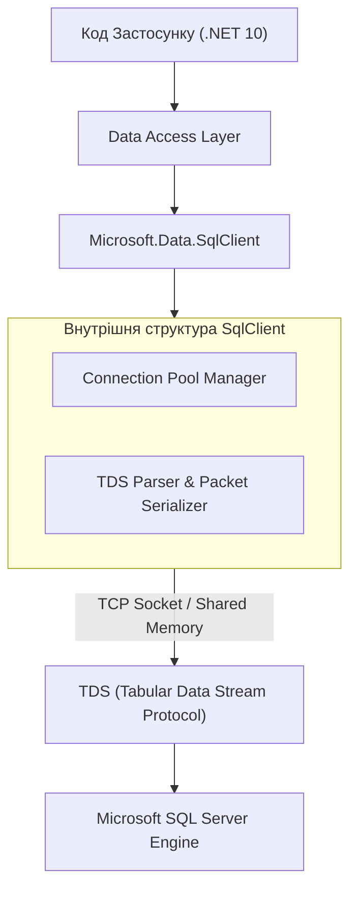
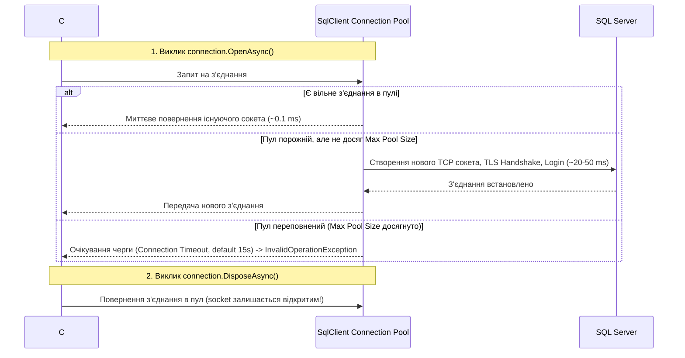
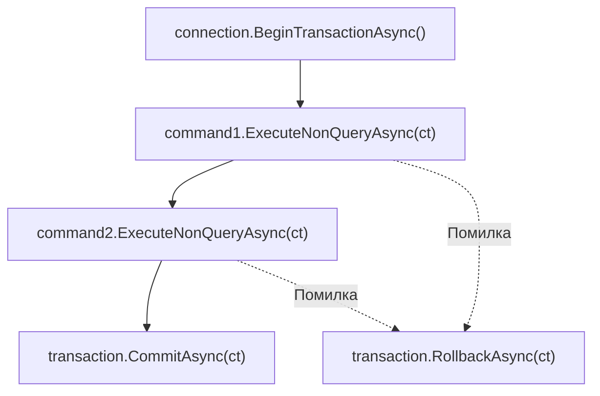

# 📘 Повний Архітектурний Довідник: ADO.NET у .NET 10
## Внутрішній устрій, протокол TDS, Connection Pooling, безпека та високонавантажені патерни

> **Автор:** Enterprise Solutions Architect & Tech Lead  
> **Стек:** .NET 10 LTS | C# 13 | Microsoft.Data.SqlClient | System.Data.Common | SQL Server  
> **Практичні приклади:** `AdoNetExamples_01` та `AdoNet-ThreeLayer-Ex-01`

---

<a id="toc"></a>
## 📑 Інтерактивний Зміст

1. [Розділ 1. Теоретична преамбула: Що таке ADO.NET і навіщо він потрібен](#section-1)
2. [Розділ 2. Яку проблему вирішує ADO.NET і чому наївний підхід ламається](#section-2)
3. [Розділ 3. Порівняльний аналіз: Наївний підхід проти Enterprise-стандарту](#section-3)
4. [Розділ 4. Внутрішня архітектура ADO.NET та бінарний протокол TDS](#section-4)
5. [Розділ 5. Connection Pooling: Фізика сокетів, конфігурація та витоки підключень](#section-5)
6. [Розділ 6. Команди та потокове читання: `SqlCommand` і `SqlDataReader`](#section-6)
7. [Розділ 7. Параметризація та захист від SQL Injection: Пастка `AddWithValue`](#section-7)
8. [Розділ 8. Управління транзакціями та рівні ізоляції ACID](#section-8)
9. [Розділ 9. Відключена модель: `SqlDataAdapter`, `DataTable` та чому це антипатерн](#section-9)
10. [Розділ 10. Еволюція у 3-рівневу архітектуру: `AdoNet-ThreeLayer-Ex-01`](#section-10)

---

<a id="section-1"></a>
## Розділ 1. Теоретична преамбула: Що таке ADO.NET і навіщо він потрібен

### 1. Що це таке простими словами
**ADO.NET (ActiveX Data Objects for .NET)** — це фундаментальний шар абстракції та набір низькорівневих інтерфейсів у платформі .NET для комунікації з реляційними базами даних.

> **Життєва аналогія:**  
> Уявіть, що реляційна СУБД (SQL Server) — це закрита автоматизована фабрика, яка спілкується виключно власною мовою радіосигналів (бінарний протокол TDS). ADO.NET — це **офіційний підземний оптоволоконний кабель та диспетчерський термінал**. Будь-який високотехнологічний сервіс (Dapper, Entity Framework Core або ваш власний сервіс) фізично не може передати сигнал на фабрику в обхід цього оптоволокна. Він змушений надсилати пакети саме по кабелю ADO.NET.

### 2. Практичне втілення в коді репозиторію
👉 [Program.cs (AdoNetExamples_01)](../AdoNetExamples_01/Program.cs) 📍 (дивіться рядки 16–28 — ініціалізація та запуск 10 сценаріїв роботи з ADO.NET)  
👉 [IExample.cs (AdoNetExamples_01)](../AdoNetExamples_01/Examples/IExample.cs) 📍 (дивіться рядки 5–15 — спільний контракт демонстраційних прикладів)

---
[⬆ До змісту](#toc) • [Наступний розділ ➡](#section-2)

---

<a id="section-2"></a>
## Розділ 2. Яку проблему вирішує ADO.NET і чому наївний підхід ламається

### 1. Яку конкретну проблему це вирішує
Коли програма взаємодіє з базою даних без строго стандартизованого моста, виникають критичні проблеми:
1. **Прив'язка до драйверів конкретної СУБД:** Без спільних абстракцій код для Oracle, SQL Server чи PostgreSQL був би несумісним. ADO.NET надає спільні базові класи (`DbConnection`, `DbCommand`, `DbDataReader`) з простору імен `System.Data.Common`.
2. **Марнотратство системних ресурсів на TCP Handshake:** Підключення до БД вимагає створення сокета, SSL/TLS рукостискання, автентифікації користувача та виділення серверної пам'яті. Без пулінгу на рівні драйвера СУБД падає вже за кількох сотень одночасних клієнтів.
3. **Небезпека SQL Injection:** Передача даних у вигляді склеєних текстових команд відкриває дірку для зловмисників. ADO.NET забезпечує бінарне передавання параметрів запиту окремо від тексту команди.

### 2. Практичне втілення в коді репозиторію
👉 [ConnectionInfoExample.cs (AdoNetExamples_01)](../AdoNetExamples_01/Examples/ConnectionInfoExample.cs) 📍 (дивіться рядки 15–40 — відкриття з'єднання та перевірка характеристик сесії)  
👉 [CreateSchemaExample.cs (AdoNetExamples_01)](../AdoNetExamples_01/Examples/CreateSchemaExample.cs) 📍 (дивіться рядки 18–45 — безпечне виконання DDL запитів створення схеми)

---
[⬅ Попередній розділ](#section-1) • [⬆ До змісту](#toc) • [Наступний розділ ➡](#section-3)

---

<a id="section-3"></a>
## Розділ 3. Порівняльний аналіз: Наївний підхід проти Enterprise-стандарту

### 1. Порівняльна таблиця рішень

| Характеристика | Як роблять зазвичай (Погано / Наївно) | Як зроблено в Enterprise (Правильно) |
| :--- | :--- | :--- |
| **Життя з'єднання** | Зберігають відкритий `SqlConnection` як статичне поле або поле сервісу на весь час | Створюють локальний `await using SqlConnection` під кожен запит, покладаючись на Connection Pool |
| **Параметризація** | Інтерполяція: `$"SELECT * FROM T WHERE Id = '{id}'"` або наївний `AddWithValue` | Явний `SqlParameter` з вказанням точного `SqlDbType` та `Size` |
| **Тип виконання** | Синхронний `Open()` та `ExecuteReader()`, що блокує потоки пулу потоків (.NET ThreadPool starvation) | Асинхронний `OpenAsync(ct)`, `ExecuteReaderAsync(ct)` з передачею `CancellationToken` |
| **Звільнення пам'яті** | Забувають закривати `SqlDataReader`, що блокує сокет і виснажує пул з'єднань | `await using` на з'єднанні, команді та читачі |
| **Транзакції** | Неконтрольовані `BEGIN TRAN` у рядку SQL без обробки винятків | Керований `await connection.BeginTransactionAsync()` з блоком `try/catch/RollbackAsync()` |

### 2. Практичне втілення в коді репозиторію
👉 [DataAccessRepository.cs (AdoNet-WebApi-Ex-01)](../AdoNet-WebApi-Ex-01/Services/DAL/DataAccessRepository.cs) 📍 (дивіться рядки 18–41 — приклад збереження `_sqlConnection` у полі, антипатерн)  
👉 [StudentRepository.cs (AdoNet-ThreeLayer-Ex-01)](../AdoNet-ThreeLayer-Ex-01/src/AdoNet.ThreeLayer.DAL/Students/StudentRepository.cs) 📍 (дивіться рядки 24–39 — правильне створення `await using SqlConnection` на кожен виклик)

---
[⬅ Попередній розділ](#section-2) • [⬆ До змісту](#toc) • [Наступний розділ ➡](#section-4)

---

<a id="section-4"></a>
## Розділ 4. Внутрішня архітектура ADO.NET та бінарний протокол TDS

### 1. Механізм протоколу TDS (Tabular Data Stream)


Комунікація між `Microsoft.Data.SqlClient` та SQL Server здійснюється за бінарним протоколом **TDS (Tabular Data Stream)**:
* Запити відправляються пакетами (за замовчуванням розмір пакета 4096 байтів).
* Якщо запит параметризований, SQL Server отримує RPC-пакет (Remote Procedure Call) `sp_executesql`, де текст запиту та параметри чітко розмежовані на рівні байтів.
* Результат повертається у вигляді потоку маркерів (tokens): метадані колонок (`COLMETADATA`), рядки даних (`ROW`), інформація про повідомлення (`MESSAGE`) та завершення виконання (`DONE`).

### 2. Практичне втілення в коді репозиторію
👉 [Db.cs (AdoNetExamples_01)](../AdoNetExamples_01/Infrastructure/Db.cs) 📍 (дивіться рядки 18–35 — формування рядка підключення через `SqlConnectionStringBuilder`)  
👉 [AppConfig.cs (AdoNetExamples_01)](../AdoNetExamples_01/Infrastructure/AppConfig.cs) 📍 (дивіться рядки 10–25 — конфігурація параметрів TDS-з'єднання з appsettings.json)

---
[⬅ Попередній розділ](#section-3) • [⬆ До змісту](#toc) • [Наступний розділ ➡](#section-5)

---

<a id="section-5"></a>
## Розділ 5. Connection Pooling: Фізика сокетів, конфігурація та витоки підключень

### 1. Механіка роботи Connection Pool


### 2. Параметри рядка підключення
* `Pooling=true;` (увімкнено за замовчуванням).
* `Min Pool Size=5;` — мінімальна кількість прогрітих з'єднань.
* `Max Pool Size=100;` — максимальний ліміт з'єднань на даний пул.
* `Connection Timeout=30;` — час очікування вивільнення з'єднання з пулу.

> [!WARNING]  
> Ніколи не динамізуйте рядок підключення включенням туди імені користувача або довільних прапорців! Кожен унікальний рядок підключення породжує **окремий ізольований пул**, що швидко призводить до вичерпання дескрипторів сокетів ОС.

### 3. Практичне втілення в коді репозиторію
👉 [ConnectionInfoExample.cs (AdoNetExamples_01)](../AdoNetExamples_01/Examples/ConnectionInfoExample.cs) 📍 (дивіться рядки 20–45 — інспекція пулу підключень та повторне відкриття сокета)  
👉 [StudentRepository.cs (AdoNet-ThreeLayer-Ex-01)](../AdoNet-ThreeLayer-Ex-01/src/AdoNet.ThreeLayer.DAL/Students/StudentRepository.cs) 📍 (дивіться рядки 24–36 та 45–53 — коректне повернення сокетів у пул через `await using`)

---
[⬅ Попередній розділ](#section-4) • [⬆ До змісту](#toc) • [Наступний розділ ➡](#section-6)

---

<a id="section-6"></a>
## Розділ 6. Команди та потокове читання: `SqlCommand` і `SqlDataReader`

### 1. `SqlCommand` та вибір методу виконання
1. `ExecuteNonQueryAsync()` — для команд `INSERT`, `UPDATE`, `DELETE`, `CREATE`, `DROP`. Повертає кількість змінених рядків.
2. `ExecuteScalarAsync()` — повертає значення першого стовпця першого рядка (наприклад, результат `SELECT COUNT(*)`).
3. `ExecuteReaderAsync()` — повертає об'єкт `SqlDataReader`.

### 2. Робота `SqlDataReader`
`SqlDataReader` не завантажує всю таблицю в пам'ять. Він є односпрямованим курсором:
* `reader.GetOrdinal("Id")` — кешуйте порядковий номер стовпця, якщо читаєте мільйони рядків, оскільки пошук за рядковим іменем виконує лінійний перебір.
* `CommandBehavior.SequentialAccess` — використовуйте для читання великих блобів (`VARBINARY(MAX)`, `VARCHAR(MAX)`), щоб читати потік байтів без попереднього завантаження всього поля в пам'ять.

### 3. Практичне втілення в коді репозиторію
👉 [DataReaderExample.cs (AdoNetExamples_01)](../AdoNetExamples_01/Examples/DataReaderExample.cs) 📍 (дивіться рядки 20–55 — курсорне читання вперед `reader.ReadAsync()`)  
👉 [ScalarQueryExample.cs (AdoNetExamples_01)](../AdoNetExamples_01/Examples/ScalarQueryExample.cs) 📍 (дивіться рядки 15–40 — виконання `COUNT`, `MIN`, `AVG` через `ExecuteScalarAsync`)  
👉 [StudentRepository.cs (AdoNet-ThreeLayer-Ex-01)](../AdoNet-ThreeLayer-Ex-01/src/AdoNet.ThreeLayer.DAL/Students/StudentRepository.cs) 📍 (дивіться рядки 97–103 — метод ручного мапінгу `Map(SqlDataReader reader)`)

---
[⬅ Попередній розділ](#section-5) • [⬆ До змісту](#toc) • [Наступний розділ ➡](#section-7)

---

<a id="section-7"></a>
## Розділ 7. Параметризація та захист від SQL Injection: Пастка `AddWithValue`

### 1. Чому `AddWithValue` — прихована небезпека?
Метод `command.Parameters.AddWithValue("@Age", age)` здається зручним, але він визначає тип параметра в рантаймі на основі типу змінної C#:
1. Для `string` він за замовчуванням надсилає тип `NVARCHAR(4000)`.
2. Якщо у базі стовпець має тип `VARCHAR(50)` (без підтримки юнікоду), SQL Server буде змушений виконати **неявне приведення типів (Implicit Conversion)** для кожного рядка таблиці!
3. Це повністю ламає використання індексів (Index Seek перетворюється на Index Scan), і запит замість 1 мілісекунди виконується 10 секунд!

### 2. Як робити правильно
```csharp
var parameter = new SqlParameter("@Title", SqlDbType.VarChar, 100)
{
    Value = title
};
command.Parameters.Add(parameter);
```

### 3. Практичне втілення в коді репозиторію
👉 [ParameterizedQueryExample.cs (AdoNetExamples_01)](../AdoNetExamples_01/Examples/ParameterizedQueryExample.cs) 📍 (дивіться рядки 18–48 — робота з параметрами запиту та захист від ін'єкцій)  
👉 [InsertDataExample.cs (AdoNetExamples_01)](../AdoNetExamples_01/Examples/InsertDataExample.cs) 📍 (дивіться рядки 20–45 — безпечна вставка рядків через параметризовані команди)

---
[⬅ Попередній розділ](#section-6) • [⬆ До змісту](#toc) • [Наступний розділ ➡](#section-8)

---

<a id="section-8"></a>
## Розділ 8. Управління транзакціями та рівні ізоляції ACID

### 1. Життєвий цикл транзакції


### 2. Рівні ізоляції (`IsolationLevel`)
* `ReadUncommitted` — дозволяє "брудне читання" (Dirty Read).
* `ReadCommitted` (дефолт SQL Server) — читаються лише зафіксовані дані.
* `RepeatableRead` — захищає від невідтворюваного читання під час транзакції.
* `Snapshot` — версійність рядків у `tempdb`, що усуває блокування між читачами та письменниками.
* `Serializable` — повне блокування діапазонів ключів (найвищий захист, найнижча пропускна здатність).

### 3. Практичне втілення в коді репозиторію
👉 [TransactionExample.cs (AdoNetExamples_01)](../AdoNetExamples_01/Examples/TransactionExample.cs) 📍 (дивіться рядки 25–65 — приклад успішного Commit та примусового Rollback при винятку)  
👉 [UpdateDeleteExample.cs (AdoNetExamples_01)](../AdoNetExamples_01/Examples/UpdateDeleteExample.cs) 📍 (дивіться рядки 18–45 — модифікація та видалення записів)

---
[⬅ Попередній розділ](#section-7) • [⬆ До змісту](#toc) • [Наступний розділ ➡](#section-9)

---

<a id="section-9"></a>
## Розділ 9. Відключена модель: `SqlDataAdapter`, `DataTable` та чому це антипатерн

### 1. Чому в сучасному вебі це антипатерн
У старих застосунках часто використовували:
```csharp
using var adapter = new SqlDataAdapter(command);
var table = new DataTable();
adapter.Fill(table);
```

1. **Алокація пам'яті:** `DataTable` обертає кожне поле в `DataColumn`, `DataRow`, зберігає історію змін кожного значення (`DataRowVersion.Original`, `Current`, `Proposed`).
2. **Boxing / Unboxing:** Будь-який доступ `(int)table.Rows[0]["Id"]` спричиняє розпаковку з `object`.
3. **Неможливість асинхронного потокового читання:** `Fill()` завжди синхронно зчитує всю таблицю в пам'ять.

### 2. Практичне втілення в коді репозиторію
👉 [DataAdapterExample.cs (AdoNetExamples_01)](../AdoNetExamples_01/Examples/DataAdapterExample.cs) 📍 (дивіться рядки 20–60 — демонстрація відключеної моделі, наповнення DataTable та оновлення через `SqlCommandBuilder`)  
👉 [DropDatabaseExample.cs (AdoNetExamples_01)](../AdoNetExamples_01/Examples/DropDatabaseExample.cs) 📍 (дивіться рядки 15–35 — очищення бази даних `DROP DATABASE`)

---
[⬅ Попередній розділ](#section-8) • [⬆ До змісту](#toc) • [Наступний розділ ➡](#section-10)

---

<a id="section-10"></a>
## Розділ 10. Еволюція у 3-рівневу архітектуру: `AdoNet-ThreeLayer-Ex-01`

### 1. Архітектурне розмежування
У проекті `AdoNet-ThreeLayer-Ex-01` низькорівневий ADO.NET ізольовано від бізнес-правил:
* **DAL:** Знає про SQL та `Microsoft.Data.SqlClient`. Інкапсулює з'єднання в `StudentRepository`.
* **BLL:** Знає лише про `IStudentRepository`, оперує валідацією, пагінацією та DTO.
* **API:** Контролери знають лише про сервіси `IStudentService`.

### 2. Практичне втілення в коді репозиторію
👉 [StudentRepository.cs (AdoNet-ThreeLayer-Ex-01 DAL)](../AdoNet-ThreeLayer-Ex-01/src/AdoNet.ThreeLayer.DAL/Students/StudentRepository.cs) 📍 (дивіться рядки 10–104 — реалізація IStudentRepository на чистому ADO.NET)  
👉 [IStudentRepository.cs (AdoNet-ThreeLayer-Ex-01 DAL)](../AdoNet-ThreeLayer-Ex-01/src/AdoNet.ThreeLayer.DAL/Students/IStudentRepository.cs) 📍 (дивіться рядки 5–25 — інтерфейс репозиторію)  
👉 [StudentService.cs (AdoNet-ThreeLayer-Ex-01 BLL)](../AdoNet-ThreeLayer-Ex-01/src/AdoNet.ThreeLayer.BLL/Students/StudentService.cs) 📍 (дивіться рядки 12–67 — бізнес-правила, пагінація та DTO)  
👉 [IStudentService.cs (AdoNet-ThreeLayer-Ex-01 BLL)](../AdoNet-ThreeLayer-Ex-01/src/AdoNet.ThreeLayer.BLL/Students/IStudentService.cs) 📍 (дивіться рядки 5–20 — інтерфейс сервісу)  
👉 [StudentsController.cs (AdoNet-ThreeLayer-Ex-01 Api)](../AdoNet-ThreeLayer-Ex-01/src/AdoNet.ThreeLayer.Api/Controllers/StudentsController.cs) 📍 (дивіться рядки 12–72 — контролер та обробка HTTP запитів)  
👉 [Program.cs (AdoNet-ThreeLayer-Ex-01 Api)](../AdoNet-ThreeLayer-Ex-01/src/AdoNet.ThreeLayer.Api/Program.cs) 📍 (дивіться рядки 11–28 — налаштування Dependency Injection та авто-бутстрап бази)

---
[⬅ Попередній розділ](#section-9) • [⬆ До змісту](#toc)
