# 🏛️ Архітектурний Майстер-Клас: Еволюція Доступу до Даних в .NET 10
## Від низькорівневого ADO.NET до Enterprise Three-Layer Architecture з Dapper Micro-ORM

> **Автор:** Enterprise Solutions Architect & Tech Lead  
> **Стек:** .NET 10 LTS | C# 13 | ADO.NET | Dapper | ASP.NET Core Web API | Clean Architecture  
> **Базові матеріали:** на основі вихідної презентації проєкту `pptx/Dapper.pptx` та практичної еволюції прикладів `Example01` – `Example04`.

---

<a id="toc"></a>
## 📋 Зміст Презентації

* [Слайд 1. Вступ та Контекст Еволюції Доступу до Даних](#slide-1)
* [Слайд 2. Огляд Екосистеми: ADO.NET vs Dapper vs Entity Framework Core](#slide-2)
* [Слайд 3. Що таке ADO.NET: Анатомія Низькорівневої Магістралі](#slide-3)
* [Слайд 4. Життєвий Цикл З'єднання та Connection Pooling у .NET](#slide-4)
* [Слайд 5. Анатомія Команд і Курсорне Читання: `SqlCommand` та `SqlDataReader`](#slide-5)
* [Слайд 6. Безпека Запитів: Параметризація проти SQL Injection](#slide-6)
* [Слайд 7. Транзакції в ADO.NET: Атомарність та Рівні Ізоляції](#slide-7)
* [Слайд 8. Відключена Модель: `SqlDataAdapter` та `DataTable` (Коли це антипатерн)](#slide-8)
* [Слайд 9. Проблема Boilerplate-коду у "Чистому" ADO.NET](#slide-9)
* [Слайд 10. Народження Micro-ORM: Що Таке Dapper та Як Він Працює Під Капотом](#slide-10)
* [Слайд 11. Внутрішня Магія Dapper: Генерація IL-коду та Кешування Десеріалізаторів](#slide-11)
* [Слайд 12. Родина Методів `Query` і Типобезпека](#slide-12)
* [Слайд 13. Одиночні Записи та Скалярні Значення: `QuerySingle`, `QueryFirst`, `ExecuteScalar`](#slide-13)
* [Слайд 14. Модифікація Даних: `Execute` та `ExecuteAsync`](#slide-14)
* [Слайд 15. Ефективність Мережі: `QueryMultiple` та `GridReader`](#slide-15)
* [Слайд 16. Гнучке Керування Параметрами: `DynamicParameters` та Списки `IN`](#slide-16)
* [Слайд 17. Збережені Процедури та Вихідні Параметри (OUTPUT)](#slide-17)
* [Слайд 18. Multi-Mapping: Зв'язок Один-до-Одного (`Product` → `Category`)](#slide-18)
* [Слайд 19. Multi-Mapping: Зв'язок Багато-до-Багатьох (`Post` ↔ `Tag`) та Проблема Дубльованих Рядків](#slide-19)
* [Слайд 20. Складні Реляційні Графи: Одночасне Об'єднання Трьох Сутностей](#slide-20)
* [Слайд 21. Управління Транзакціями у Dapper та Патерн Unit of Work](#slide-21)
* [Слайд 22. Продуктивність на Масштабі: Batching, `SqlBulkCopy` та Dapper Plus](#slide-22)
* [Слайд 23. Архітектурний Патерн: Трьохрівнева Архітектура (Clean 3-Layer)](#slide-23)
* [Слайд 24. Порівняння Реалізацій: Example 01–04 у Репозиторії](#slide-24)
* [Слайд 25. Підсумки та Enterprise Гайдлайн Вибору Інструментів](#slide-25)

---

<a id="slide-1"></a>
### Слайд 1. Вступ та Контекст Еволюції Доступу до Даних

#### 1. Теоретичне ядро
* **Життєва аналогія:** Доступ до бази даних можна порівняти з транспортуванням вантажів:
  * *Чистий ADO.NET* — це ручне перенесення кожної коробки по окремому кабелю з власноручним підключенням контактів.
  * *Dapper* — це швидкісний автоматизований контейнеровоз з маркуванням, який миттєво розкладає вантаж по полицях.
  * *Entity Framework Core* — це автономний роботизований логістичний хаб, який бере на себе все планування, але вимагає багато енергії та налаштувань.
* **Яку проблему це вирішує:** Розробники часто опиняються перед дилемою: або писати сотні рядків громіздкого коду на ADO.NET, або віддавати повний контроль важкому ORM, втрачаючи швидкість та прозорість SQL.
* **Архітектурна перевага:** Розуміння спектру від ADO.NET до Dapper дозволяє будувати високопродуктивні enterprise-системи без зайвих абстракцій.

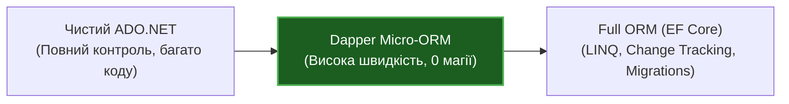

#### 2. Посилання на код у репозиторії
👉 [README.md](../README.md) 📍 (загальний огляд рішень репозиторію)

---
[⬆ До змісту](#toc) • [Наступний слайд ➡](#slide-2)

---

<a id="slide-2"></a>
### Слайд 2. Огляд Екосистеми: ADO.NET vs Dapper vs Entity Framework Core

#### 1. Теоретичне ядро
* **Суть:** Dapper не конкурує з ADO.NET — він є надбудовою над ним. Водночас Dapper і EF Core чудово доповнюють один одного в моделі CQRS.
* **Порівняльна таблиця:**

| Критерій | "Чистий" ADO.NET | Dapper Micro-ORM | Entity Framework Core |
| :--- | :--- | :--- | :--- |
| **Генерація SQL** | Відсутня (ручний SQL) | Відсутня (ручний SQL) | Автоматична через LINQ-провайдер |
| **Мапінг результату** | 100% ручний (`reader.Get*`) | Автоматичний (IL emit) | Автоматичний (Change Tracker) |
| **Швидкість читання** | Базова (еталон: 100%) | 98–99% від ADO.NET | 60–85% залежно від складності |
| **Change Tracking** | Немає | Немає | Є з коробки |
| **Міграції схеми** | Власні SQL-скрипти | Власні SQL-скрипти | Автоматичні міграції |
| **Контроль запитів** | Абсолютний | Абсолютний | Опосередкований через LINQ |

> [!NOTE]  
> "Обирайте інструмент, виходячи з 95% завдань, які ви вирішуєте щодня, а не з 5% винятків."

---
[⬅ Попередній слайд](#slide-1) • [⬆ До змісту](#toc) • [Наступний слайд ➡](#slide-3)

---

<a id="slide-3"></a>
### Слайд 3. Що таке ADO.NET: Анатомія Низькорівневої Магістралі

#### 1. Теоретичне ядро
* **Життєва аналогія:** ADO.NET — це фундамент залізничного полотна. Усі потяги (Dapper, EF Core, NHibernate) їздять по цих рейках.
* **Ключові абстракції:**
  * `DbConnection` (`SqlConnection`) — фізичне/логічне з'єднання з сервером.
  * `DbCommand` (`SqlCommand`) — інструкція (текст SQL або ім'я процедури) з параметрами.
  * `DbDataReader` (`SqlDataReader`) — односпрямований курсор для читання потоку байтів через протокол TDS (Tabular Data Stream).
  * `DbTransaction` (`SqlTransaction`) — контекст транзакції бази даних.
* **Архітектурний принцип:** Повна ізоляція від платформних специфік за допомогою інтерфейсів `System.Data.Common`.

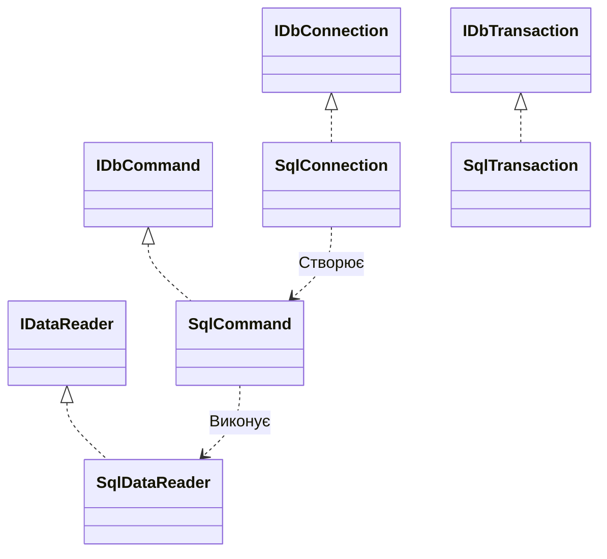

#### 2. Посилання на код у репозиторії
👉 [ConnectionInfoExample.cs](../AdoNetExamples_01/Examples/ConnectionInfoExample.cs) 📍 (дивіться рядки 15–40)

---
[⬅ Попередній слайд](#slide-2) • [⬆ До змісту](#toc) • [Наступний слайд ➡](#slide-4)

---

<a id="slide-4"></a>
### Слайд 4. Життєвий Цикл З'єднання та Connection Pooling у .NET

#### 1. Теоретичне ядро
* **Аналогія:** Пул з'єднань — це служба таксі біля аеропорту. Автомобілі вже заведені й прогріті; коли пасажир сідає — машина просто рушає, а після поїздки повертається на стоянку.
* **Проблема:** Створення фізичного TCP-з'єднання з SQL Server, проходження TLS-рукостискання та авторизації займає десятки мілісекунд.
* **Як працює `using var connection = new SqlConnection(...)`:**
  * Виклик `OpenAsync()` не створює нове TCP-з'єднання, а бере вільний сокет із пулу за лічені мікросекунди.
  * Виклик `DisposeAsync()` не рве фізичне підключення, а повертає його назад у пул!

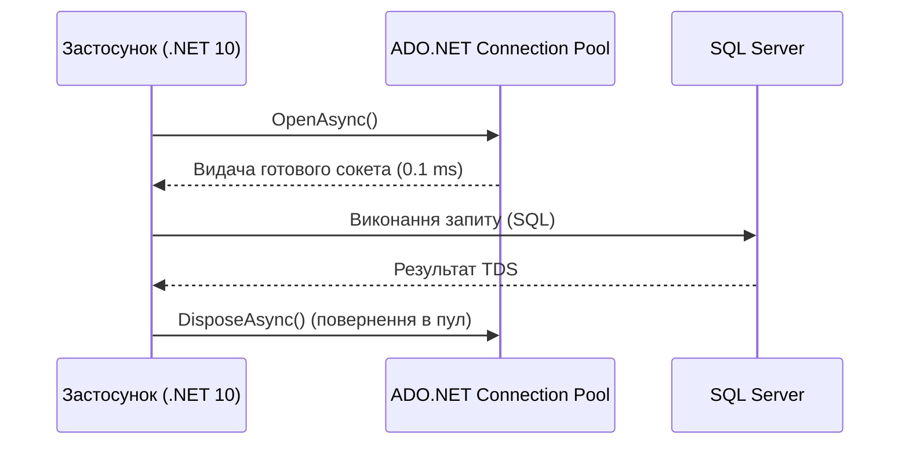

#### 2. Посилання на код у репозиторії
👉 [Db.cs](../AdoNetExamples_01/Infrastructure/Db.cs) 📍 (дивіться рядки 12–35)

---
[⬅ Попередній слайд](#slide-3) • [⬆ До змісту](#toc) • [Наступний слайд ➡](#slide-5)

---

<a id="slide-5"></a>
### Слайд 5. Анатомія Команд і Курсорне Читання: `SqlCommand` та `SqlDataReader`

#### 1. Теоретичне ядро
* **Суть:** `SqlDataReader` — це найшвидший спосіб отримати дані з SQL Server у пам'ять CLR.
* **Принцип "Forward-Only / Read-Only":**
  * Читач тримає відкритий потік і переміщується лише вперед (`reader.ReadAsync()`).
  * Дані не кешуються в пам'яті всією таблицею — ви обробляєте один рядок за раз.
* **Порівняльна таблиця підходів:**

| Підхід | Плюси | Мінуси |
| :--- | :--- | :--- |
| **`SqlDataReader`** | Мінімальне споживання RAM, миттєвий початок читання | Ручний мапінг стовпців, блокування сокета до закриття |
| **`DataTable`** | Зручно для швидкого прототипування | Величезні накладні витрати пам'яті, boxing/unboxing |

#### 2. Посилання на код у репозиторії
👉 [DataReaderExample.cs](../AdoNetExamples_01/Examples/DataReaderExample.cs) 📍 (дивіться рядки 20–55)

---
[⬅ Попередній слайд](#slide-4) • [⬆ До змісту](#toc) • [Наступний слайд ➡](#slide-6)

---

<a id="slide-6"></a>
### Слайд 6. Безпека Запитів: Параметризація проти SQL Injection

#### 1. Теоретичне ядро
* **Аналогія:** Параметризований запит — це бланк паспорта, де фото та ім'я вставляються у строго відведені віконця. Конкатенація рядків — це дозвіл будь-кому домальовувати печатки та підписи поверх документу.
* **Чому конкатенація — критична вразливість:**
  `$"SELECT * FROM Users WHERE Login = '{login}'"` при введенні `' OR 1=1 --` ламає всю логіку безпеки.
* **Перевага параметризації для SQL Server:**
  * Сервер кешує скомпільований план виконання (Execution Plan).
  * Параметри передаються строго типізованими бінарними значеннями в окремому пакеті протоколу TDS.

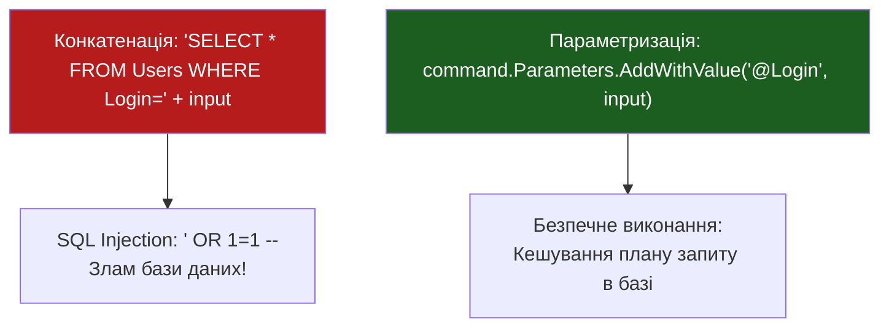

#### 2. Посилання на код у репозиторії
👉 [ParameterizedQueryExample.cs](../AdoNetExamples_01/Examples/ParameterizedQueryExample.cs) 📍 (дивіться рядки 18–48)

---
[⬅ Попередній слайд](#slide-5) • [⬆ До змісту](#toc) • [Наступний слайд ➡](#slide-7)

---

<a id="slide-7"></a>
### Слайд 7. Транзакції в ADO.NET: Атомарність та Рівні Ізоляції

#### 1. Теоретичне ядро
* **Аналогія:** Банківський переказ — списати гроші з рахунку А і нарахувати на рахунок Б. Якщо між цими діями зникне живлення, гроші не повинні зникнути у повітрі.
* **ACID властивості:**
  * **Atomicity** — або всі команди виконуються успішно, або жодна.
  * **Consistency** — база переходить з одного валідного стану в інший.
  * **Isolation** — паралельні транзакції не бачать незафіксовані зміни одна одної.
  * **Durability** — після Commit результат гарантовано збережено на диск.
* **Важлива особливість .NET:** Блок `using` автоматично викликає `Dispose()`, але для збереження змін потрібен обов'язковий явний виклик `Commit()` або `CommitAsync()`!

#### 2. Посилання на код у репозиторії
👉 [TransactionExample.cs](../AdoNetExamples_01/Examples/TransactionExample.cs) 📍 (дивіться рядки 25–65)

---
[⬅ Попередній слайд](#slide-6) • [⬆ До змісту](#toc) • [Наступний слайд ➡](#slide-8)

---

<a id="slide-8"></a>
### Слайд 8. Відключена Модель: `SqlDataAdapter` та `DataTable` (Коли це антипатерн)

#### 1. Теоретичне ядро
* **Суть відключеної моделі:** З'єднання відкривається, витягує всі дані у локальний кеш у пам'яті (`DataSet`/`DataTable`), після чого з'єднання негайно закривається.
* **Чому в сучасних Web API це антипатерн:**
  1. `DataTable` створює колосальне навантаження на Garbage Collector через алокації метаданих, рядків та колонок.
  2. Відсутність типобезпеки: кожен доступ до поля призводить до боксингу `object` та ризику помилок часу виконання.
  3. `SqlCommandBuilder` генерує важкі та неоптимальні команди оновлення.

| Підхід | Використання пам'яті | Типобезпека | Придатність для Web API |
| :--- | :--- | :--- | :--- |
| **`SqlDataAdapter` + `DataTable`** | Дуже високе (об'єктне дерево) | Слабкі типи (`row["Name"]`) | ❌ Не рекомендовано |
| **Dapper / Typed POCO** | Мінімальне (прямий POCO) | Сувора компіляторна | ✅ Enterprise Стандарт |

#### 2. Посилання на код у репозиторії
👉 [DataAdapterExample.cs](../AdoNetExamples_01/Examples/DataAdapterExample.cs) 📍 (дивіться рядки 20–60)

---
[⬅ Попередній слайд](#slide-7) • [⬆ До змісту](#toc) • [Наступний слайд ➡](#slide-9)

---

<a id="slide-9"></a>
### Слайд 9. Проблема Boilerplate-коду у "Чистому" ADO.NET

#### 1. Теоретичне ядро
* **Аналогія:** Уявіть, що щоб відправити електронного листа, вам щоразу потрібно вручну відкривати сокет, формувати SMTP-заголовки, кодувати Base64 та рахувати хеш.
* **Що доводиться писати вручну в ADO.NET:**
  1. Створення з'єднання та команди.
  2. Ручне додавання кожного параметра з типом.
  3. Виклик `ExecuteReader`.
  4. Цикл `while (reader.Read())`.
  5. Ручне зчитування `reader.GetInt32(reader.GetOrdinal("Id"))`.
  6. Обробка `DBNull.Value`.
* **Результат:** 20–30 рядків коду для простого запиту з 5 полями!

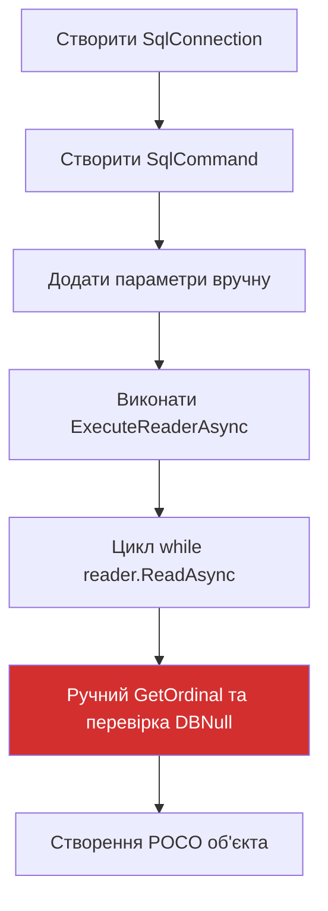

#### 2. Посилання на код у репозиторії
👉 [StudentRepository.cs (Pure ADO.NET)](../AdoNet-ThreeLayer-Ex-01/src/AdoNet.ThreeLayer.DAL/Students/StudentRepository.cs) 📍 (дивіться рядки 19–39 та 97–103)

---
[⬅ Попередній слайд](#slide-8) • [⬆ До змісту](#toc) • [Наступний слайд ➡](#slide-10)

---

<a id="slide-10"></a>
### Слайд 10. Народження Micro-ORM: Що Таке Dapper та Як Він Працює Під Капотом

#### 1. Теоретичне ядро
* **Хто створив:** Сем Сафрон і Марк Гравелл для **Stack Overflow** — сайту з мільярдами переглядів, де кожна мікросекунда та мегабайт пам'яті мають вирішальне значення.
* **Філософія:**
  * Фокус виключно на літерах **O** та **M** в абревіатурі ORM — **Object Mapping**.
  * Ніякої прихованої генерації SQL.
  * Пряме розширення інтерфейсу `System.Data.IDbConnection`.
* **Результат:** Понад 350 мільйонів завантажень на NuGet і статус де-факто стандарту швидкого доступу до даних у .NET.

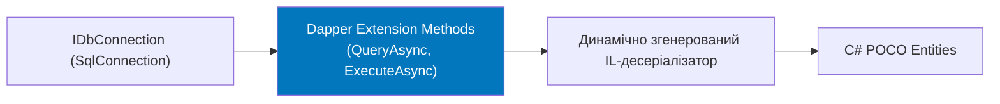

#### 2. Посилання на код у репозиторії
👉 [StudentRepository.cs (Dapper)](../AdoNet-ThreeLayer-Ex-02/src/AdoNet.ThreeLayer.Dapper.DAL/Students/StudentRepository.cs) 📍 (дивіться рядки 27–42)

---
[⬅ Попередній слайд](#slide-9) • [⬆ До змісту](#toc) • [Наступний слайд ➡](#slide-11)

---

<a id="slide-11"></a>
### Слайд 11. Внутрішня Магія Dapper: Генерація IL-коду та Кешування Десеріалізаторів

#### 1. Теоретичне ядро
* **Чому рефлексія повільна:** Класичний `Type.GetProperty()` та `SetValue()` повільні у циклах на тисячі рядків.
* **Секрет швидкості Dapper:**
  1. При першому виконанні запиту Dapper інспектує схему `IDataReader`.
  2. За допомогою `System.Reflection.Emit.DynamicMethod` генерує прямий IL-байткод, еквівалентний вручну скомпільованому C# мапінгу!
  3. Делегат десеріалізатора кешується за складеним ключем:  
     `CacheKey = (SqlText, CommandType, ConnectionType, ColumnHash)`.
  4. Наступні виклики виконуються з максимально можливою швидкістю процесора!

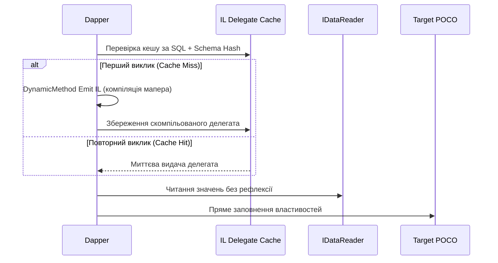

#### 2. Посилання на код у репозиторії
👉 [StudentRepository.cs (Dapper DAL)](../AdoNet-ThreeLayer-Ex-02/src/AdoNet.ThreeLayer.Dapper.DAL/Students/StudentRepository.cs) 📍 (дивіться рядки 33–42 — Dapper компілює IL-десеріалізатор для Student при першому виклику QueryAsync)  
👉 [Student.cs (Ex-02 DAL)](../AdoNet-ThreeLayer-Ex-02/src/AdoNet.ThreeLayer.Dapper.DAL/Students/Student.cs) 📍 (дивіться рядки 1–15 — POCO-сутність з властивостями Id, Name, Email для автомапінгу)

---
[⬅ Попередній слайд](#slide-10) • [⬆ До змісту](#toc) • [Наступний слайд ➡](#slide-12)

---

<a id="slide-12"></a>
### Слайд 12. Родина Методів `Query` і Типобезпека

#### 1. Теоретичне ядро
* **Суть:** Dapper надає сімейство методів читання під будь-які вимоги синхронності та типізації:

| Метод | Що повертає | Опис та рекомендація |
| :--- | :--- | :--- |
| `Query(sql)` | `IEnumerable<dynamic>` | Швидкі перевірки; не рекомендується через ризик runtime-помилок |
| `Query<T>(sql)` | `IEnumerable<T>` | Синхронне типізоване читання |
| `QueryAsync(sql)` | `Task<IEnumerable<dynamic>>` | Асинхронний динамічний запит |
| `QueryAsync<T>(sql)` | `Task<IEnumerable<T>>` | **Enterprise Стандарт**: асинхронне безпечне читання |

> [!TIP]  
> Завжди використовуйте `QueryAsync<T>` з передачею `CommandDefinition` і `CancellationToken`. Це захищає ваші сервери від завислих підключень при скасуванні клієнтських HTTP-запитів!

#### 2. Посилання на код у репозиторії
👉 [StudentRepository.cs](../AdoNet-ThreeLayer-Ex-02/src/AdoNet.ThreeLayer.Dapper.DAL/Students/StudentRepository.cs) 📍 (дивіться рядки 27–42)

---
[⬅ Попередній слайд](#slide-11) • [⬆ До змісту](#toc) • [Наступний слайд ➡](#slide-13)

---

<a id="slide-13"></a>
### Слайд 13. Одиночні Записи та Скалярні Значення: `QuerySingle`, `QueryFirst`, `ExecuteScalar`

#### 1. Теоретичне ядро
* **Семантична різниця методів вибірки одиночного елемента:**

| Метод | Якщо рядків 0 | Якщо рядків 1 | Якщо рядків > 1 |
| :--- | :--- | :--- | :--- |
| `QuerySingle<T>` | 💥 `InvalidOperationException` | ✅ Повертає `T` | 💥 `InvalidOperationException` |
| `QuerySingleOrDefault<T>` | 🟡 Повертає `default` / `null` | ✅ Повертає `T` | 💥 `InvalidOperationException` |
| `QueryFirst<T>` | 💥 `InvalidOperationException` | ✅ Повертає `T` | ✅ Бере перший рядок |
| `QueryFirstOrDefault<T>` | 🟡 Повертає `default` / `null` | ✅ Повертає `T` | ✅ Бере перший рядок |

* **Скалярні запити:**
  Для виклику `COUNT(*)`, `MAX(Price)` використовується `ExecuteScalarAsync<T>`, який автоматично розпаковує тип у потрібний примітив (наприклад, `int`).

#### 2. Посилання на код у репозиторії
👉 [StudentRepository.cs](../AdoNet-ThreeLayer-Ex-02/src/AdoNet.ThreeLayer.Dapper.DAL/Students/StudentRepository.cs) 📍 (дивіться рядки 44–66)

---
[⬅ Попередній слайд](#slide-12) • [⬆ До змісту](#toc) • [Наступний слайд ➡](#slide-14)

---

<a id="slide-14"></a>
### Слайд 14. Модифікація Даних: `Execute` та `ExecuteAsync`

#### 1. Теоретичне ядро
* **Призначення:** Єдиний уніфікований метод для операцій `INSERT`, `UPDATE`, `DELETE`, `DDL`.
* **Що повертає:** Ціле число (`int`) — кількість зачеплених рядків (`Rows Affected`).
* **Автоматична передача сутності:**
  Замість ручного перерахунку властивостей, Dapper дозволяє передати об'єкт безпосередньо:
  ```csharp
  await connection.ExecuteAsync(sql, new { student.Name, student.Email }, cancellationToken: ct);
  ```

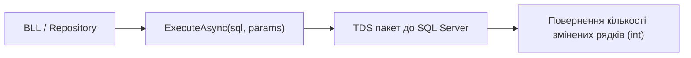

#### 2. Посилання на код у репозиторії
👉 [StudentRepository.cs](../AdoNet-ThreeLayer-Ex-02/src/AdoNet.ThreeLayer.Dapper.DAL/Students/StudentRepository.cs) 📍 (дивіться рядки 67–88)

---
[⬅ Попередній слайд](#slide-13) • [⬆ До змісту](#toc) • [Наступний слайд ➡](#slide-15)

---

<a id="slide-15"></a>
### Слайд 15. Ефективність Мережі: `QueryMultiple` та `GridReader`

#### 1. Теоретичне ядро
* **Аналогія:** Замість того щоб двічі їздити кур'єром у магазин за хлібом і молоком окремо, ви робите одне замовлення і забираєте обидва пакети разом.
* **Проблема:** Якщо сторінці потрібне замовлення (`Order`) та його рядки (`OrderItem`), два окремі запити призводять до двох затримок мережі (2 Network Round-trips).
* **Рішення Dapper:** Метод `QueryMultipleAsync` виконує пакет запитів за одне підключення та повертає `GridReader`:
  ```csharp
  const string sql = "SELECT * FROM Orders WHERE Id = @Id; SELECT * FROM OrderItems WHERE OrderId = @Id;";
  using var multi = await connection.QueryMultipleAsync(sql, new { Id = orderId });
  var order = await multi.ReadSingleOrDefaultAsync<Order>();
  var items = (await multi.ReadAsync<OrderItem>()).ToList();
  ```

```mermaid
sequenceDiagram
    participant App as Застосунок
    participant DB as База Даних
    Note over App,DB: Один похід у базу замість двох!
    App->>DB: SQL: "SELECT * FROM Orders...; SELECT * FROM OrderItems...;"
    DB-->>App: GridReader (Потік з двома результуючими наборами)
    App->>App: Послідовне зчитування multi.ReadAsync()
```

#### 2. Посилання на код у репозиторії
👉 [StudentRepository.cs (Dapper DAL)](../AdoNet-ThreeLayer-Ex-02/src/AdoNet.ThreeLayer.Dapper.DAL/Students/StudentRepository.cs) 📍 (дивіться рядки 27–42 — базове читання наборів)  
👉 [Dapper-Architecture-Guide.md](Dapper-Architecture-Guide.md) 📍 (дивіться Розділ 6 — детальна реалізація QueryMultipleAsync з GridReader)

---
[⬅ Попередній слайд](#slide-14) • [⬆ До змісту](#toc) • [Наступний слайд ➡](#slide-16)

---

<a id="slide-16"></a>
### Слайд 16. Гнучке Керування Параметрами: `DynamicParameters` та Списки `IN`

#### 1. Теоретичне ядро
* **Розгортання списків `IN`:**
  У чистому ADO.NET побудова запиту з `WHERE Id IN (@id1, @id2, ...)` вимагає динамічної генерації SQL.  
  Dapper робить це "з коробки":
  ```csharp
  var products = await connection.QueryAsync<Product>(
      "SELECT * FROM Products WHERE Id IN @Ids",
      new { Ids = new[] { 1, 5, 10 } });
  ```
* **`DynamicParameters`:**
  Використовується, коли набір параметрів формується у рантаймі (наприклад, складні фільтри пошуку) або потрібен контроль над вихідними значеннями.

#### 2. Посилання на код у репозиторії
👉 [StudentRepository.cs (Dapper DAL)](../AdoNet-ThreeLayer-Ex-02/src/AdoNet.ThreeLayer.Dapper.DAL/Students/StudentRepository.cs) 📍 (дивіться рядки 38–40 — параметризація через анонімні об'єкти)  
👉 [ParameterizedQueryExample.cs (AdoNetExamples_01)](../AdoNetExamples_01/Examples/ParameterizedQueryExample.cs) 📍 (дивіться рядки 18–48 — порівняння з ручною передачею параметрів у ADO.NET)

---
[⬅ Попередній слайд](#slide-15) • [⬆ До змісту](#toc) • [Наступний слайд ➡](#slide-17)

---

<a id="slide-17"></a>
### Слайд 17. Збережені Процедури та Вихідні Параметри (OUTPUT)

#### 1. Теоретичне ядро
* **Чому `CommandType.StoredProcedure`:**
  Виклик процедури за її іменем без конкатенації `EXEC StoredProc ...` гарантує типобезпеку, убезпечує від синтаксичних помилок та дозволяє отримувати значення вихідних параметрів.
* **Приклад роботи з `OUTPUT` параметром:**
  ```csharp
  var parameters = new DynamicParameters();
  parameters.Add("@StudentId", 42);
  parameters.Add("@TotalCourses", dbType: DbType.Int32, direction: ParameterDirection.Output);

  await connection.ExecuteAsync("sp_GetStudentStats", parameters, commandType: CommandType.StoredProcedure);

  int totalCourses = parameters.Get<int>("@TotalCourses");
  ```

#### 2. Посилання на код у репозиторії
👉 [ParameterizedQueryExample.cs (AdoNetExamples_01)](../AdoNetExamples_01/Examples/ParameterizedQueryExample.cs) 📍 (дивіться рядки 35–45 — вихідні параметри ParameterDirection.Output)  
👉 [Dapper-Architecture-Guide.md](Dapper-Architecture-Guide.md) 📍 (дивіться Розділ 7 — конфігурація DynamicParameters у Dapper)

---
[⬅ Попередній слайд](#slide-16) • [⬆ До змісту](#toc) • [Наступний слайд ➡](#slide-18)

---

<a id="slide-18"></a>
### Слайд 18. Multi-Mapping: Зв'язок Один-до-Одного (`Product` → `Category`)

#### 1. Теоретичне ядро
* **Суть:** Часто запит витягує дані з кількох об'єднаних таблиць (`JOIN`). Як розкласти один плаский рядок у дерево об'єктів C#?
* **Механіка `splitOn`:**
  Параметр `splitOn` вказує стовпець, з якого починається наступний об'єкт.
  * Усе до цього стовпця десеріалізується в перший тип.
  * Усе, починаючи з нього — у другий.

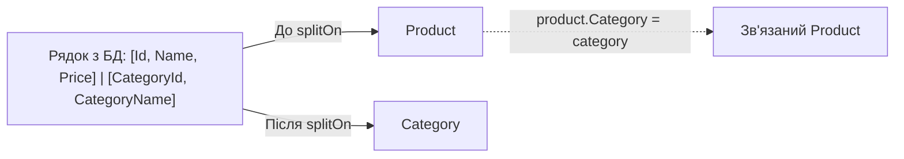

```csharp
const string sql = @"
    SELECT p.ProductID, p.ProductName, c.CategoryID, c.CategoryName 
    FROM Products p 
    INNER JOIN Categories c ON p.CategoryID = c.CategoryID";

var list = await connection.QueryAsync<Product, Category, Product>(
    sql,
    (product, category) => { product.Category = category; return product; },
    splitOn: "CategoryID");
```

#### 2. Посилання на код у репозиторії
👉 [Student.cs (Ex-02 DAL)](../AdoNet-ThreeLayer-Ex-02/src/AdoNet.ThreeLayer.Dapper.DAL/Students/Student.cs) 📍 (дивіться рядки 1–15 — структура POCO-сутності для мапінгу)  
👉 [StudentModels.cs (Ex-02 BLL)](../AdoNet-ThreeLayer-Ex-02/src/AdoNet.ThreeLayer.Dapper.BLL/Students/StudentModels.cs) 📍 (дивіться рядки 1–25 — перетворення сутностей DAL у DTO)

---
[⬅ Попередній слайд](#slide-17) • [⬆ До змісту](#toc) • [Наступний слайд ➡](#slide-19)

---

<a id="slide-19"></a>
### Слайд 19. Multi-Mapping: Зв'язок Багато-до-Багатьох (`Post` ↔ `Tag`) та Проблема Дубльованих Рядків

#### 1. Теоретичне ядро
* **Проблема Картезіанського множення (Cartesian product):**
  При `INNER JOIN` таблиці постів і таблиці тегів пост дублюється стільки разів, скільки тегів він має!
* **Архітектурне вирішення через `Dictionary` / `GroupBy`:**
  1. Зберігаємо унікальні пости в `Dictionary<int, Post>`.
  2. Для кожного рядка додаємо знайдений тег у колекцію `post.Tags`.
  3. Повертаємо виключно унікальні екземпляри постів.

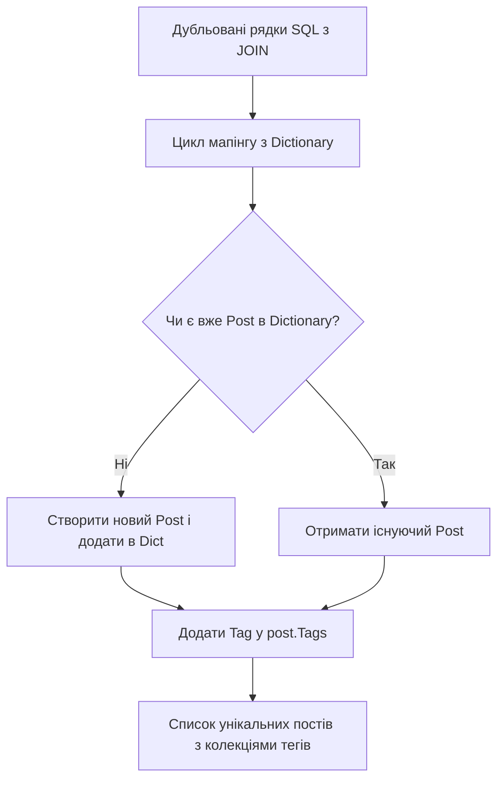

#### 2. Посилання на код у репозиторії
👉 [StudentService.cs (Ex-02 BLL)](../AdoNet-ThreeLayer-Ex-02/src/AdoNet.ThreeLayer.Dapper.BLL/Students/StudentService.cs) 📍 (дивіться рядки 21–31 — трансформація та вибірка результатів)  
👉 [Dapper-Architecture-Guide.md](Dapper-Architecture-Guide.md) 📍 (дивіться Розділ 8 — вирішення проблеми дублювання через Dictionary та GroupBy)

---
[⬅ Попередній слайд](#slide-18) • [⬆ До змісту](#toc) • [Наступний слайд ➡](#slide-20)

---

<a id="slide-20"></a>
### Слайд 20. Складні Реляційні Графи: Одночасне Об'єднання Трьох Сутностей

#### 1. Теоретичне ядро
* **Сценарій:** Отримати пост разом з автором (`Author`) та списком тегів (`Tags`).
* **Синтаксис Dapper з декількома `splitOn`:**
  ```csharp
  const string sql = @"
      SELECT p.PostId, p.Headline, a.AuthorId, a.FullName, t.TagId, t.TagName
      FROM Posts p
      INNER JOIN Authors a ON p.AuthorId = a.AuthorId
      INNER JOIN PostTags pt ON pt.PostId = p.PostId
      INNER JOIN Tags t ON t.TagId = pt.TagId";

  var postDict = new Dictionary<int, Post>();
  var result = await connection.QueryAsync<Post, Author, Tag, Post>(
      sql,
      (post, author, tag) =>
      {
          if (!postDict.TryGetValue(post.PostId, out var currentPost))
          {
              currentPost = post;
              currentPost.Author = author;
              postDict.Add(currentPost.PostId, currentPost);
          }
          currentPost.Tags.Add(tag);
          return currentPost;
      },
      splitOn: "AuthorId,TagId");
  ```

#### 2. Посилання на код у репозиторії
👉 [Dapper-Architecture-Guide.md](Dapper-Architecture-Guide.md) 📍 (дивіться Розділ 8 — приклад об'єднання 3 сутностей Post + Author + Tag зі splitOn: "AuthorId,TagId")  
👉 [StudentRepository.cs (Ex-02 DAL)](../AdoNet-ThreeLayer-Ex-02/src/AdoNet.ThreeLayer.Dapper.DAL/Students/StudentRepository.cs) 📍 (дивіться рядки 27–42)

---
[⬅ Попередній слайд](#slide-19) • [⬆ До змісту](#toc) • [Наступний слайд ➡](#slide-21)

---

<a id="slide-21"></a>
### Слайд 21. Управління Транзакціями у Dapper та Патерн Unit of Work

#### 1. Теоретичне ядро
* **Суть:** Dapper приймає об'єкт транзакції `IDbTransaction` як параметр команди.
* **Золоте правило:**
  Всі команди в рамках транзакції повинні виконуватися через одне й те саме відкрите з'єднання і передавати один і той самий екземпляр транзакції!
* **Коректний патерн `try / catch`:**
  ```csharp
  await using var connection = new SqlConnection(connectionString);
  await connection.OpenAsync();
  await using var transaction = await connection.BeginTransactionAsync();

  try
  {
      await connection.ExecuteAsync(sql1, param1, transaction);
      await connection.ExecuteAsync(sql2, param2, transaction);
      await transaction.CommitAsync();
  }
  catch
  {
      await transaction.RollbackAsync();
      throw;
  }
  ```

#### 2. Посилання на код у репозиторії
👉 [TransactionExample.cs (AdoNetExamples_01)](../AdoNetExamples_01/Examples/TransactionExample.cs) 📍 (дивіться рядки 25–65 — еталонний патерн `try / catch / Rollback` при транзакції)  
👉 [StudentRepository.cs (Ex-02 DAL)](../AdoNet-ThreeLayer-Ex-02/src/AdoNet.ThreeLayer.Dapper.DAL/Students/StudentRepository.cs) 📍 (дивіться рядки 68–78 — атомарні операції запису)

---
[⬅ Попередній слайд](#slide-20) • [⬆ До змісту](#toc) • [Наступний слайд ➡](#slide-22)

---

<a id="slide-22"></a>
### Слайд 22. Продуктивність на Масштабі: Batching, `SqlBulkCopy` та Dapper Plus

#### 1. Теоретичне ядро
* **Проблема наївного циклу `foreach`:**
  Виконання `connection.ExecuteAsync(insertSql, item)` у циклі на 10 000 записів надсилає 10 000 окремих мережевих запитів. Це займає хвилини!
* **Градація продуктивності масової вставки:**

| Метод | 10 000 рядків (час) | Коментар |
| :--- | :--- | :--- |
| Цикл `Execute` | ~45-60 секунд | ❌ Антипатерн для великих обсягів |
| Пакетний Dapper `Execute(list)` | ~8-12 секунд | Dapper пакує кілька команд в один виклик |
| `SqlBulkCopy` (ADO.NET) | ~0.3-0.5 секунди | ✅ Прямий бінарний streaming у таблицю |
| Dapper Plus `BulkInsert` | ~0.4-0.6 секунди | Платне розширення поверх bulk copy |

#### 2. Посилання на код у репозиторії
👉 [InsertDataExample.cs (AdoNetExamples_01)](../AdoNetExamples_01/Examples/InsertDataExample.cs) 📍 (дивіться рядки 20–45 — послідовна вставка рядків)  
👉 [DatabaseBootstrapper.cs (Ex-02 DAL)](../AdoNet-ThreeLayer-Ex-02/src/AdoNet.ThreeLayer.Dapper.DAL/Infrastructure/DatabaseBootstrapper.cs) 📍 (дивіться рядки 60–80 — пакетна вставка тестових даних студентів)

---
[⬅ Попередній слайд](#slide-21) • [⬆ До змісту](#toc) • [Наступний слайд ➡](#slide-23)

---

<a id="slide-23"></a>
### Слайд 23. Архітектурний Патерн: Трьохрівнева Архітектура (Clean 3-Layer)

#### 1. Теоретичне ядро
* **Аналогія:** Ресторан високої кухні:
  * **API (Офіціант)** — спілкується з гостем (HTTP), приймає меню, повертає рахунок. Не готує їжу!
  * **BLL (Шеф-кухар)** — знає бізнес-правила (рецепти, свіжість, калькуляція). Не знає, хто постачальник продуктів!
  * **DAL (Склад / Постачальник)** — знає, як дістати продукти (SQL, Dapper, з'єднання). Не обслуговує клієнтів!
* **Принцип спрямованості залежностей:**
  Шар API посилається на BLL та DAL (Composition Root). Шар BLL ніколи не залежить від деталей реалізації бази даних, лише від абстракції інтерфейсу репозиторію `IStudentRepository`!

```mermaid
flowchart TD
    API["ШАР 1: API (Controllers, Swagger, HTTP)"] --> BLL["ШАР 2: BLL (Services, DTOs, Validation)"]
    BLL --> RepoInterface["IStudentRepository (Контракт)"]
    DAL["ШАР 3: DAL (Dapper / ADO.NET, Entities)"] -.->|Реалізує| RepoInterface
    API -.->|Composition Root (DI)| DAL
    style API fill:#e3f2fd,stroke:#1565c0,color:#0d47a1
    style BLL fill:#fff3e0,stroke:#e65100,color:#e65100
    style DAL fill:#e8f5e9,stroke:#2e7d32,color:#1b5e20
```

#### 2. Посилання на код у репозиторії
👉 [DependencyInjection.cs (DAL)](../AdoNet-ThreeLayer-Ex-02/src/AdoNet.ThreeLayer.Dapper.DAL/DependencyInjection.cs) 📍 (дивіться рядки 10–25)  
👉 [DependencyInjection.cs (BLL)](../AdoNet-ThreeLayer-Ex-02/src/AdoNet.ThreeLayer.Dapper.BLL/DependencyInjection.cs) 📍 (дивіться рядки 10–20)  
👉 [Program.cs (Api)](../AdoNet-ThreeLayer-Ex-02/src/AdoNet.ThreeLayer.Dapper.Api/Program.cs) 📍 (дивіться рядки 10–22)

---
[⬅ Попередній слайд](#slide-22) • [⬆ До змісту](#toc) • [Наступний слайд ➡](#slide-24)

---

<a id="slide-24"></a>
### Слайд 24. Порівняння Реалізацій: Example 01–04 у Репозиторії

#### 1. Теоретичне ядро
* **Еволюційний шлях репозиторію:**

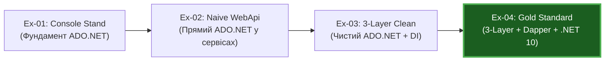

* **Порівняльна таблиця проектів у репозиторії:**

| Проєкт | Архітектура | Технологія доступу | Переваги та обмеження |
| :--- | :--- | :--- | :--- |
| **`AdoNetExamples_01`** | Консольний стенд | Чистий ADO.NET | 10 ізольованих фундаментальних прикладів |
| **`AdoNet-WebApi-Ex-01`** | Монолітний сервіс | ADO.NET (Single connection) | Демонструє типові помилки початківців |
| **`AdoNet-ThreeLayer-Ex-01`** | 3-рівнева архітектура | Чистий ADO.NET | Чіткі межі шарів, але ручний `Map(reader)` |
| **`AdoNet-ThreeLayer-Ex-02`** | 3-рівнева архітектура | **Dapper + .NET 10** | **Зразковий стандарт**: 0 boilerplate, висока швидкість |

#### 2. Посилання на код у репозиторії
👉 [Example 03 Repository](../AdoNet-ThreeLayer-Ex-01/src/AdoNet.ThreeLayer.DAL/Students/StudentRepository.cs) 📍 (дивіться рядки 20–104)  
👉 [Example 04 Repository](../AdoNet-ThreeLayer-Ex-02/src/AdoNet.ThreeLayer.Dapper.DAL/Students/StudentRepository.cs) 📍 (дивіться рядки 20–92)

---
[⬅ Попередній слайд](#slide-23) • [⬆ До змісту](#toc) • [Наступний слайд ➡](#slide-25)

---

<a id="slide-25"></a>
### Слайд 25. Підсумки та Enterprise Гайдлайн Вибору Інструментів

#### 1. Теоретичне ядро
* **Головні висновки майстер-класу:**
  1. **Dapper = ADO.NET + швидкісний об'єктний мапінг** без прихованої магії.
  2. Завжди використовуйте **параметризовані запити** через анонімні об'єкти або `DynamicParameters`.
  3. Розділяйте обов'язки системи: HTTP-шар, бізнес-правила та доступ до даних повинні бути незалежними.
  4. Асинхронність із `CancellationToken` — обов'язкова вимога сучасного Web API.
* **Матриця прийняття рішень для архітектора:**

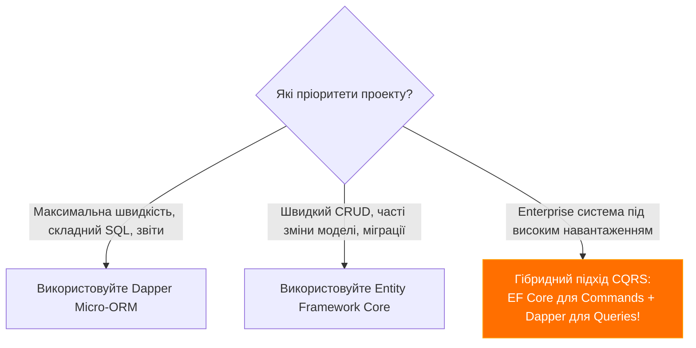

#### 2. Посилання на корисні ресурси
* 📘 [Повний гайд по ADO.NET](AdoNet-Architecture-Guide.md)
* ⚡ [Повний гайд по Dapper Micro-ORM](Dapper-Architecture-Guide.md)
* 🌐 Офіційний сайт Dapper: [learndapper.com](https://www.learndapper.com)
* 🐙 GitHub репозиторій: [github.com/DapperLib/Dapper](https://github.com/DapperLib/Dapper)

---
[⬅ Попередній слайд](#slide-24) • [⬆ До змісту](#toc)
