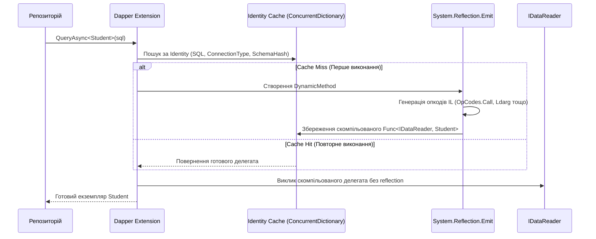
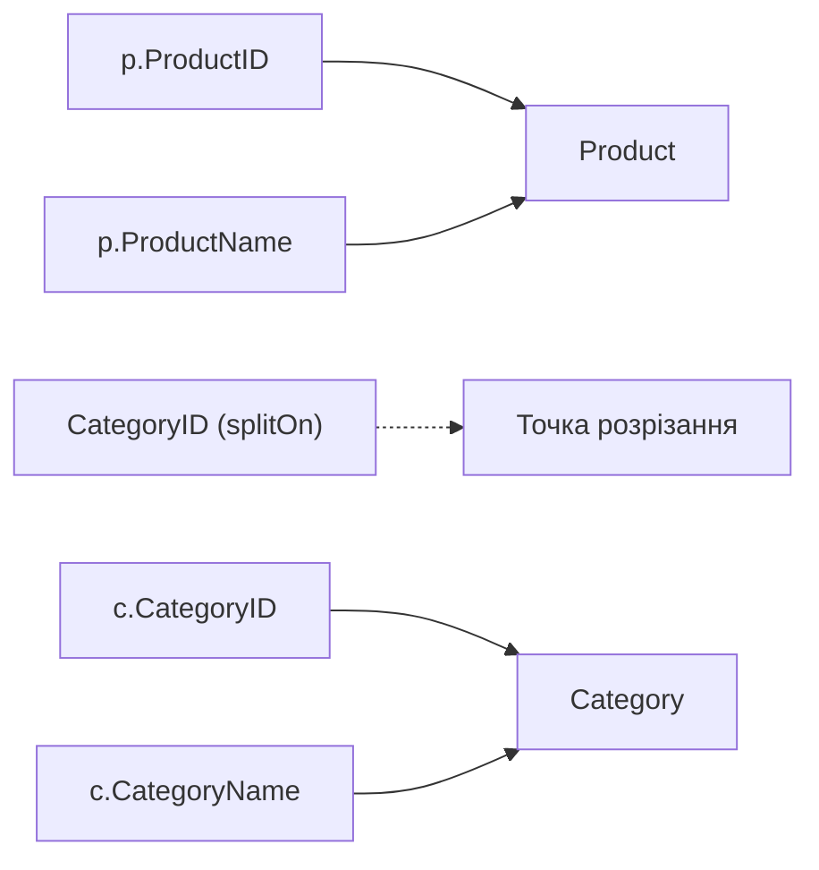

# ⚡ Повний Архітектурний Довідник: Dapper Micro-ORM у .NET 10
## Внутрішня будова (IL Emit), методи Query/Execute, Multi-Mapping, транзакції та Clean Architecture

> **Автор:** Enterprise Solutions Architect & Tech Lead  
> **Стек:** .NET 10 LTS | C# 13 | Dapper 2.1+ | Microsoft.Data.SqlClient | Clean 3-Layer Architecture  
> **Практичний зразок:** `AdoNet-ThreeLayer-Ex-02` (Gold Standard)

---

<a id="toc"></a>
## 📑 Інтерактивний Зміст

1. [Розділ 1. Теоретична преамбула: Філософія Dapper Micro-ORM](#section-1)
2. [Розділ 2. Яку проблему вирішує Dapper: Смерть ручного мапінгу](#section-2)
3. [Розділ 3. Порівняльний аналіз: ADO.NET vs Dapper vs Entity Framework Core](#section-3)
4. [Розділ 4. Внутрішній устрій Dapper: DynamicMethod, IL Emit та кешування десеріалізаторів](#section-4)
5. [Розділ 5. Базові інтерфейси та сигнатури методів](#section-5)
6. [Розділ 6. Читання даних: від скаляра до множинних наборів (GridReader)](#section-6)
7. [Розділ 7. Параметризація запитів: Анонімні типи, DynamicParameters та IN-списки](#section-7)
8. [Розділ 8. Multi-Mapping та робота зі зв'язками (1:1, 1:N, N:M)](#section-8)
9. [Розділ 9. Управління транзакціями та патерн Unit of Work](#section-9)
10. [Розділ 10. Масові операції (Bulk Operations) та гранична продуктивність](#section-10)
11. [Розділ 11. Архітектурна інтеграція у Three-Layer Clean Architecture](#section-11)

---

<a id="section-1"></a>
## Розділ 1. Теоретична преамбула: Філософія Dapper Micro-ORM

### 1. Що це таке простими словами
**Dapper** — це надшвидка мікро-ORM бібліотека, реалізована як набір високоефективних методів розширення (`extension methods`) для базового інтерфейсу `System.Data.IDbConnection`.

> **Життєва аналогія:**  
> Якщо ADO.NET — це необроблений потік руди, яку ви маєте вручну сортувати пінцетом по одній піщинці (`reader.GetInt32`, `reader.GetString`), а Entity Framework Core — це велетенський завод з сотнями конвеєрів та юристів (Change Tracker, Identity Map, Proxy Generation), то **Dapper — це швидкісний синхронний 3D-принтер**. Він отримує на вхід креслення (SQL) і струмінь матеріалу (TDS потік), миттєво відливаючи з нього готові деталі (C# POCO об'єкти) на максимальній швидкості апаратного заліза.

### 2. Практичне втілення в коді репозиторію
👉 [StudentRepository.cs (AdoNet-ThreeLayer-Ex-02 DAL)](../AdoNet-ThreeLayer-Ex-02/src/AdoNet.ThreeLayer.Dapper.DAL/Students/StudentRepository.cs) 📍 (дивіться рядки 18–43 — використання Dapper-методів QueryAsync замість циклу while)  
👉 [Student.cs (AdoNet-ThreeLayer-Ex-02 DAL)](../AdoNet-ThreeLayer-Ex-02/src/AdoNet.ThreeLayer.Dapper.DAL/Students/Student.cs) 📍 (дивіться рядки 1–15 — POCO-сутність з властивостями Id, Name, Email для автомапінгу)

---
[⬆ До змісту](#toc) • [Наступний розділ ➡](#section-2)

---

<a id="section-2"></a>
## Розділ 2. Яку проблему вирішує Dapper: Смерть ручного мапінгу

### 1. Проблеми класичного підходу
1. **Ліквідація рутинного коду (Boilerplate):** Усуває необхідність вручну викликати `GetOrdinal`, писати цикли `while (reader.Read())` та перевіряти `reader.IsDBNull`.
2. **Нульова деградація продуктивності:** На відміну від повних ORM, які витрачають процесорний час на побудову дерев виразів (Expression Trees), перевірку стану сутностей у Change Tracker та генерацію складного SQL, Dapper не робить нічого зайвого.
3. **100% передбачуваність SQL:** Розробник та DBA мають абсолютний контроль над кожним символом у тексті запиту, планом виконання та використанням індексів.

### 2. Порівняння реалізацій у коді проєкту
👉 [StudentRepository.cs (Чистий ADO.NET, Ex-01)](../AdoNet-ThreeLayer-Ex-01/src/AdoNet.ThreeLayer.DAL/Students/StudentRepository.cs) 📍 (дивіться рядки 31–38 та 97–103 — 15 рядків ручного мапінгу)  
👉 [StudentRepository.cs (Dapper, Ex-02)](../AdoNet-ThreeLayer-Ex-02/src/AdoNet.ThreeLayer.Dapper.DAL/Students/StudentRepository.cs) 📍 (дивіться рядки 38–41 — 1 рядок `connection.QueryAsync<Student>(command)`)

---
[⬅ Попередній розділ](#section-1) • [⬆ До змісту](#toc) • [Наступний розділ ➡](#section-3)

---

<a id="section-3"></a>
## Розділ 3. Порівняльний аналіз: ADO.NET vs Dapper vs Entity Framework Core

### 1. Порівняльна матриця

| Аспект | Чистий ADO.NET | Dapper Micro-ORM | Entity Framework Core |
| :--- | :--- | :--- | :--- |
| **Код мапінгу** | Ручний (10–50 рядків на запит) | Автоматичний (1 рядок: `.QueryAsync<T>()`) | Автоматичний (через DbSet) |
| **Швидкість читання** | Еталон (100%) | 98–99% від ADO.NET | 60–85% (без AsNoTracking гірше) |
| **Накладні витрати пам'яті** | Мінімальні | Мінімальні (нульові алокації метаданих) | Помірні / Високі (залежно від трекінгу) |
| **Складні звіти / агрегати** | Складно писати мапінг вручну | Ідеально підходить | Часто генерує неоптимальний SQL |
| **Міграції схеми** | Власні SQL скрипти | Власні SQL скрипти | Потужні міграції з коробки |

### 2. Практичне втілення в коді репозиторію
👉 [AdoNet.ThreeLayer.Dapper.DAL.csproj](../AdoNet-ThreeLayer-Ex-02/src/AdoNet.ThreeLayer.Dapper.DAL/AdoNet.ThreeLayer.Dapper.DAL.csproj) 📍 (дивіться рядки 11–15 — легковажні залежності Dapper і SqlClient без важких ORM)  
👉 [DatabaseBootstrapper.cs (Ex-02)](../AdoNet-ThreeLayer-Ex-02/src/AdoNet.ThreeLayer.Dapper.DAL/Infrastructure/DatabaseBootstrapper.cs) 📍 (дивіться рядки 20–55 — прямий SQL-скрипт ініціалізації БД замість міграцій EF Core)

---
[⬅ Попередній розділ](#section-2) • [⬆ До змісту](#toc) • [Наступний розділ ➡](#section-4)

---

<a id="section-4"></a>
## Розділ 4. Внутрішній устрій Dapper: DynamicMethod, IL Emit та кешування десеріалізаторів

### 1. Механізм IL-генерації
Чому Dapper працює так само швидко, як ручний C# код?



### 2. Анатомія ключа кешування (`Identity`)
Dapper створює унікальний ключ кешу, що враховує:
1. Текст SQL-запиту;
2. Тип команди (`CommandType.Text` або `CommandType.StoredProcedure`);
3. Тип підключення (`Microsoft.Data.SqlClient.SqlConnection`);
4. Цільовий тип даних (`typeof(Student)`);
5. Хеш метаданих стовпців з першого рядка `IDataReader`.

Завдяки цьому наступні виклики працюють **без витрат на рефлексію** — викликається чистий скомпільований IL-байткод!

### 3. Практичне втілення в коді репозиторію
👉 [StudentRepository.cs (Ex-02)](../AdoNet-ThreeLayer-Ex-02/src/AdoNet.ThreeLayer.Dapper.DAL/Students/StudentRepository.cs) 📍 (дивіться рядки 34–42 — Dapper компілює мапер для моделі Student при першому виклику `QueryAsync<Student>`)

---
[⬅ Попередній розділ](#section-3) • [⬆ До змісту](#toc) • [Наступний розділ ➡](#section-5)

---

<a id="section-5"></a>
## Розділ 5. Базові інтерфейси та сигнатури методів

### 1. Головні extension-методи
Dapper не створює нових типів з'єднань — він розширює `System.Data.IDbConnection`:
* `QueryAsync<T>` — читання набору сутностей.
* `QueryFirstOrDefaultAsync<T>` — пошук одного запису або null.
* `ExecuteAsync` — виконання команд модифікації (INSERT/UPDATE/DELETE).
* `ExecuteScalarAsync<T>` — скалярні обчислення з автоматичною типізацією.

> [!TIP]  
> **Структура `CommandDefinition`:**  
> Рекомендується замість довгих списків параметрів використовувати `CommandDefinition`. Вона є `readonly struct` (не створює алокацій у купі) і дозволяє передавати `CancellationToken`, керувати таймаутами та прапорцями виконання в єдиному місці.

### 2. Практичне втілення в коді репозиторію
👉 [IStudentRepository.cs (Ex-02)](../AdoNet-ThreeLayer-Ex-02/src/AdoNet.ThreeLayer.Dapper.DAL/Students/IStudentRepository.cs) 📍 (дивіться рядки 10–26 — контракт методів репозиторію з підтримкою CancellationToken)  
👉 [StudentRepository.cs (Ex-02)](../AdoNet-ThreeLayer-Ex-02/src/AdoNet.ThreeLayer.Dapper.DAL/Students/StudentRepository.cs) 📍 (дивіться рядки 38, 52, 63, 75, 85 — використання CommandDefinition в усіх методах)

---
[⬅ Попередній розділ](#section-4) • [⬆ До змісту](#toc) • [Наступний розділ ➡](#section-6)

---

<a id="section-6"></a>
## Розділ 6. Читання даних: від скаляра до множинних наборів (GridReader)

### 1. Робота зі списками та скалярами
```csharp
// Пагінована сторінка
var command = new CommandDefinition(sql, new { Offset = offset, PageSize = pageSize }, cancellationToken: ct);
var students = await connection.QueryAsync<Student>(command);
return students.AsList();

// Скалярне значення
return await connection.ExecuteScalarAsync<int>(new CommandDefinition(sql, cancellationToken: ct));
```

### 2. Множинні результуючі набори (`GridReader`)
Якщо запит витягує одночасно кілька таблиць (наприклад, замовлення та позиції):
```csharp
const string sql = "SELECT * FROM Orders WHERE Id = @Id; SELECT * FROM OrderItems WHERE OrderId = @Id;";
await using var multi = await connection.QueryMultipleAsync(sql, new { Id = orderId });
var order = await multi.ReadSingleOrDefaultAsync<Order>();
var items = (await multi.ReadAsync<OrderItem>()).ToList();
```

### 3. Практичне втілення в коді репозиторію
👉 [StudentRepository.cs (Ex-02)](../AdoNet-ThreeLayer-Ex-02/src/AdoNet.ThreeLayer.Dapper.DAL/Students/StudentRepository.cs) 📍 (дивіться рядки 27–42 для GetPageAsync та рядки 44–53 для CountAsync)  
👉 [StudentRepository.cs (Ex-02)](../AdoNet-ThreeLayer-Ex-02/src/AdoNet.ThreeLayer.Dapper.DAL/Students/StudentRepository.cs) 📍 (дивіться рядки 55–66 для GetByIdAsync)

---
[⬅ Попередній розділ](#section-5) • [⬆ До змісту](#toc) • [Наступний розділ ➡](#section-7)

---

<a id="section-7"></a>
## Розділ 7. Параметризація запитів: Анонімні типи, DynamicParameters та IN-списки

### 1. Зручність анонімних типів
Dapper зчитує властивості анонімного об'єкта та підставляє їх як змінні команди `@Param`:
```csharp
await connection.ExecuteAsync(sql, new { student.Name, student.Email }, cancellationToken: ct);
```

### 2. Списки для оператора `IN`
У Dapper достатньо передати масив або `IEnumerable`:
```csharp
var ids = new[] { 1, 2, 3, 5, 8 };
var result = await connection.QueryAsync<Student>(
    "SELECT * FROM Students WHERE Id IN @Ids",
    new { Ids = ids });
```
*Dapper самостійно розгортає `@Ids` у `@Ids1, @Ids2, @Ids3...` та підставляє параметри.*

### 3. Практичне втілення в коді репозиторію
👉 [StudentRepository.cs (Ex-02)](../AdoNet-ThreeLayer-Ex-02/src/AdoNet.ThreeLayer.Dapper.DAL/Students/StudentRepository.cs) 📍 (дивіться рядки 74–77 — передача властивостей `{ student.Name, student.Email }` у ExecuteAsync)  
👉 [StudentRepository.cs (Ex-02)](../AdoNet-ThreeLayer-Ex-02/src/AdoNet.ThreeLayer.Dapper.DAL/Students/StudentRepository.cs) 📍 (дивіться рядки 83–87 — параметризація видалення за Id)

---
[⬅ Попередній розділ](#section-6) • [⬆ До змісту](#toc) • [Наступний розділ ➡](#section-8)

---

<a id="section-8"></a>
## Розділ 8. Multi-Mapping та робота зі зв'язками (1:1, 1:N, N:M)

### 1. Механізм `splitOn`
За замовчуванням Dapper шукає стовпець `Id` для розбиття типів. Якщо стовпець розділення називається інакше, його слід вказати в `splitOn`:



### 2. Зв'язок Один-до-Багатьох (`Order` -> `List<OrderItem>`)
```csharp
var orderDict = new Dictionary<int, Order>();

var result = await connection.QueryAsync<Order, OrderItem, Order>(
    @"SELECT o.Id, o.OrderDate, i.Id, i.ProductName, i.Quantity 
      FROM Orders o 
      INNER JOIN OrderItems i ON o.Id = i.OrderId",
    (order, item) =>
    {
        if (!orderDict.TryGetValue(order.Id, out var currentOrder))
        {
            currentOrder = order;
            currentOrder.Items = new List<OrderItem>();
            orderDict.Add(currentOrder.Id, currentOrder);
        }
        currentOrder.Items.Add(item);
        return currentOrder;
    },
    splitOn: "Id");
```

### 3. Практичне втілення в коді репозиторію
👉 [Student.cs (Ex-02 DAL)](../AdoNet-ThreeLayer-Ex-02/src/AdoNet.ThreeLayer.Dapper.DAL/Students/Student.cs) 📍 (дивіться рядки 1–15 — структура сутності для зіставлення колонок)  
👉 [StudentModels.cs (Ex-02 BLL)](../AdoNet-ThreeLayer-Ex-02/src/AdoNet.ThreeLayer.Dapper.BLL/Students/StudentModels.cs) 📍 (дивіться рядки 1–25 — проекція сутностей у вихідні моделі DTO)

---
[⬅ Попередній розділ](#section-7) • [⬆ До змісту](#toc) • [Наступний розділ ➡](#section-9)

---

<a id="section-9"></a>
## Розділ 9. Управління транзакціями та патерн Unit of Work

### 1. Атомарне виконання команд у Dapper
Транзакція передається явно в кожен виклик команди Dapper:
```csharp
await using var connection = new SqlConnection(_connectionString);
await connection.OpenAsync(ct);
await using var transaction = await connection.BeginTransactionAsync(ct);

try
{
    await connection.ExecuteAsync(new CommandDefinition(sql1, param1, transaction: transaction, cancellationToken: ct));
    await connection.ExecuteAsync(new CommandDefinition(sql2, param2, transaction: transaction, cancellationToken: ct));
    await transaction.CommitAsync(ct);
}
catch
{
    await transaction.RollbackAsync(ct);
    throw;
}
```

### 2. Практичне втілення в коді репозиторію
👉 [TransactionExample.cs (AdoNetExamples_01)](../AdoNetExamples_01/Examples/TransactionExample.cs) 📍 (дивіться рядки 25–65 — еталонна реалізація блоку транзакції з відкатом при винятку)  
👉 [StudentRepository.cs (Ex-02 DAL)](../AdoNet-ThreeLayer-Ex-02/src/AdoNet.ThreeLayer.Dapper.DAL/Students/StudentRepository.cs) 📍 (дивіться рядки 68–78 — атомарні операції запису)

---
[⬅ Попередній розділ](#section-8) • [⬆ До змісту](#toc) • [Наступний розділ ➡](#section-10)

---

<a id="section-10"></a>
## Розділ 10. Масові операції (Bulk Operations) та гранична продуктивність

### 1. Способи вставки великих обсягів
1. **Невеликі пакети (до 500 записів):**  
   Dapper підтримує пакетне виконання при передачі списку об'єктів у `ExecuteAsync`:
   ```csharp
   await connection.ExecuteAsync("INSERT INTO Students (Name, Email) VALUES (@Name, @Email)", studentList);
   ```
2. **Великі обсяги (1 000 – 1 000 000+ записів):**  
   Для високих навантажень використовується `SqlBulkCopy` (з ADO.NET) або бібліотека розширення `Dapper Plus`:
   ```csharp
   using var bulk = new SqlBulkCopy(connection);
   bulk.DestinationTableName = "Students";
   await bulk.WriteToServerAsync(dataTable, ct);
   ```

### 2. Практичне втілення в коді репозиторію
👉 [InsertDataExample.cs (AdoNetExamples_01)](../AdoNetExamples_01/Examples/InsertDataExample.cs) 📍 (дивіться рядки 20–45 — послідовна вставка даних)  
👉 [DatabaseBootstrapper.cs (Ex-02 DAL)](../AdoNet-ThreeLayer-Ex-02/src/AdoNet.ThreeLayer.Dapper.DAL/Infrastructure/DatabaseBootstrapper.cs) 📍 (дивіться рядки 60–80 — пакетна вставка початкових тестових даних через ExecuteAsync)

---
[⬅ Попередній розділ](#section-9) • [⬆ До змісту](#toc) • [Наступний розділ ➡](#section-11)

---

<a id="section-11"></a>
## Розділ 11. Архітектурна інтеграція у Three-Layer Clean Architecture

### 1. Архітектурні межі та зв'язки
У проекті `AdoNet-ThreeLayer-Ex-02`:
* **DAL:** Знає про Dapper, `CommandDefinition`, SQL. Повертає POCO сутності `Student`.
* **BLL:** Не має жодної залежності від Dapper! Працює з чистим інтерфейсом `IStudentRepository`.
* **API:** Контролери працюють з `IStudentService`, забезпечуючи повну незалежність шарів.

```mermaid
flowchart TD
    API["ШАР 1: API (Controllers, Swagger, DI Root)"] --> BLL["ШАР 2: BLL (Services, DTOs, Validation)"]
    BLL --> RepoInterface["IStudentRepository (Контракт)"]
    DAL["ШАР 3: DAL (Dapper, SqlConnection, Entities)"] -.->|Реалізує| RepoInterface
    API -.->|Composition Root (DI Registration)| DAL
```

### 2. Практичне втілення в коді репозиторію
👉 [StudentRepository.cs (Ex-02 DAL)](../AdoNet-ThreeLayer-Ex-02/src/AdoNet.ThreeLayer.Dapper.DAL/Students/StudentRepository.cs) 📍 (дивіться рядки 18–91 — повна реалізація сховища даних на Dapper)  
👉 [DependencyInjection.cs (Ex-02 DAL)](../AdoNet-ThreeLayer-Ex-02/src/AdoNet.ThreeLayer.Dapper.DAL/DependencyInjection.cs) 📍 (дивіться рядки 10–25 — реєстрація сервісів DAL у DI контейнері)  
👉 [StudentService.cs (Ex-02 BLL)](../AdoNet-ThreeLayer-Ex-02/src/AdoNet.ThreeLayer.Dapper.BLL/Students/StudentService.cs) 📍 (дивіться рядки 12–67 — бізнес-правила без залежності від Dapper)  
👉 [DependencyInjection.cs (Ex-02 BLL)](../AdoNet-ThreeLayer-Ex-02/src/AdoNet.ThreeLayer.Dapper.BLL/DependencyInjection.cs) 📍 (дивіться рядки 10–20 — реєстрація сервісів BLL)  
👉 [StudentsController.cs (Ex-02 Api)](../AdoNet-ThreeLayer-Ex-02/src/AdoNet.ThreeLayer.Dapper.Api/Controllers/StudentsController.cs) 📍 (дивіться рядки 12–74 — контролер з повною підтримкою Swagger)  
👉 [Program.cs (Ex-02 Api)](../AdoNet-ThreeLayer-Ex-02/src/AdoNet.ThreeLayer.Dapper.Api/Program.cs) 📍 (дивіться рядки 10–39 — composition root, авто-ініціалізація БД та Swagger UI)

---
[⬅ Попередній розділ](#section-10) • [⬆ До змісту](#toc)
